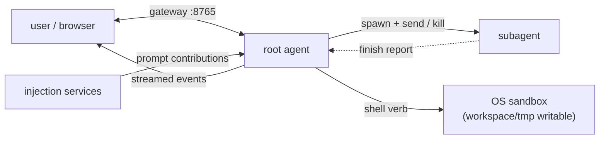

  <picture>
    <source media="(prefers-color-scheme: dark)" srcset="docs/assets/nan-title-dark.png">
    
  </picture>

# NAN-itself

A self-contained, local-first agent core. One asyncio task per
agent; handles for a multi-agent spawn tree; external processes
for prompt injection; the shell as the universal tool surface --
inside an OS-level sandbox. Built to run against locally deployed
models as well as frontier APIs.

> **NAN-itself is in early development.** Interfaces may change without notice.

## Quick start

    uv sync

Fill in the active model in `config/nan.yaml` (the only config
source; any OpenAI-compatible or Anthropic endpoint works):

    llm:
      provider: openai
      api_key: ""
      model: ""

Run:

    uv run nan

The web UI comes up on `http://127.0.0.1:8765`. Talk to the root
agent; it can spawn subagents, run shell commands in its sandboxed
workspace, and hold conversations across turns.

## How it works

- **One agent = one asyncio task.** Turns run continuously,
  paced by configuration; messages queue at turn boundaries.
- **Handles.** A spawned child is reached through a handle:
  send messages in, kill it. Handles are held by spawners and
  not transferable, so when an agent dies everything it holds
  dies with it.
- **Injection services.** Prompt contributions come from
  independent local processes over a small HTTP protocol --
  no in-process plugin system.
- **Shell-first.** Tools and skills are plain files; the agent
  reaches them with shell commands inside the sandbox.
- **The turn is the record.** Every turn keeps what it drained,
  collected, observed and replied; rendered history freezes and
  is add-only, keeping the prompt prefix cache-friendly.

## Documentation

| Document | Contents |
|---|---|
| [Get started](docs/for-users/get-started.md) | Install, configure, run |
| [Configuration](docs/for-users/configuration.md) | Every key in `config/nan.yaml` |
| [Security model](docs/for-users/security.md) | Trust model, entry guard, sandbox |
| [Injection services](docs/for-service-authors/injection-service.md) | Write a prompt-contributor service |
| [Architecture](docs/for-contributors/architecture.md) | How the core is built |
| [Principles](docs/for-contributors/principles.md) | The design rules |
| [Frontend protocol](docs/for-contributors/frontend-protocol.md) | The event stream contract |
| [Developing](docs/for-contributors/develop.md) | Test, lint, type-check |

## Repository layout

    nan/          the core package (the only runtime code)
    builtin/      read-only resources the agent reaches through shell
    config/       nan.yaml -- the single configuration source
    frontend/     the gateway's web UI (built to frontend/dist)
    workspace/    the agents' writable territory (services live in
                  workspace/services/, one uv project each)
    tests/        pytest suite
    docs/         this documentation

## License

Apache-2.0. See [LICENSE](LICENSE).
