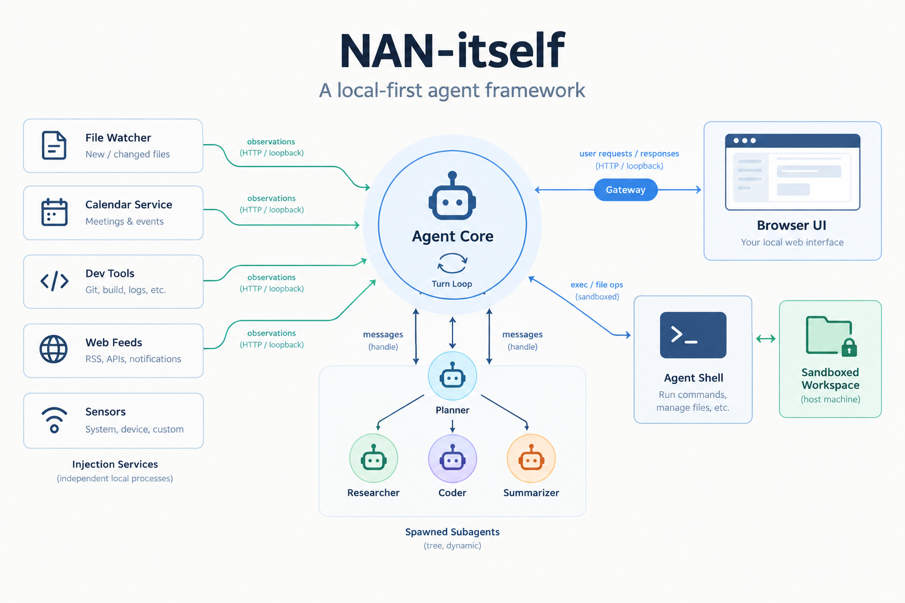

  <picture>
    <source media="(prefers-color-scheme: dark)" srcset="docs/assets/nan-title-dark.png">
    
  </picture>

# NAN-itself

**NAN is a local-first, self-extending agent.**

It runs on your machine and can connect to a local model or a frontier API.
During operation, it can acquire new capabilities on demand: install a CLI into its sandbox, write a skill file, connect a service.
Capabilities are files, and NAN uses capabilities through the shell.

> **NAN-itself is in early development.** Interfaces may change without notice.

## Quick start

> **Windows users**: install [WSL2](https://learn.microsoft.com/en-us/windows/wsl/install)
> and run NAN inside it. NAN is not natively compatible with Windows:
> it executes the agent's shell commands inside an OS-level sandbox
> (sandbox-exec on macOS, bubblewrap on Linux), and Windows has no
> equivalent process-isolation mechanism; the rest of the runtime
> (bash boot scripts, POSIX paths, the shell-first tooling) builds
> on that same Unix foundation. Inside WSL2 everything works as on
> Linux.

    uv sync

Copy the config template -- the resulting `config/nan.yaml` is
git-ignored because it holds your key -- then fill in the active model
(the only config source; any OpenAI-compatible or Anthropic endpoint
works):

    cp config/nan.yaml.example config/nan.yaml

    llm:
      provider: openai
      api_key: ""
      model: ""

Build the web UI (from the repo root):

    cd frontend && npm install && npm run build && cd ..

Run:

    uv run nan

The web UI comes up on `http://127.0.0.1:8765` once
`frontend/dist/index.html` exists; without it the gateway serves
only `/ws` and `/surfaces`. Talk to the root agent; it can spawn
subagents, run shell commands in its sandboxed workspace, and hold
conversations across turns.

## How it works

  

- **One agent = one asyncio task.** Turns run continuously,
  paced by configuration; messages queue at turn boundaries.
- **Handles.** A spawned child is reached through a handle:
  send messages in, kill it. Handles are held by spawners and
  not transferable, so when an agent dies everything it holds
  dies with it.
- **Injection services.** Prompt contributions come from
  independent local processes over a small HTTP protocol
- **Shell-first.** Tools and skills are plain files; the agent
  reaches them with shell commands inside the sandbox.
- **The turn is the record.** Every turn keeps what it drained,
  collected, observed and replied; rendered history freezes and
  is add-only, keeping the prompt prefix cache-friendly.

## Documentation

| Document | Contents |
|---|---|
| [Get started](docs/for-users/get-started.md) | Install, configure, run |
| [Configuration](docs/for-users/configuration.md) | Every key in `config/nan.yaml` |
| [Security model](SECURITY.md) | Trust model, entry guard, sandbox |
| [Injection services](docs/for-service-authors/injection-service.md) | Write a prompt-contributor service |
| [Architecture](docs/for-contributors/architecture.md) | How the core is built |
| [Principles](docs/for-contributors/principles.md) | The design rules |
| [Frontend protocol](docs/for-contributors/frontend-protocol.md) | The event stream contract |
| [Developing](docs/for-contributors/develop.md) | Test, lint, type-check |

## Repository layout

    nan/          the core package (the only runtime code)
    builtin/      user-owned resources the agent reads but never
                  writes: skills, services/, autostart.sh
    config/       nan.yaml -- the single configuration source
    frontend/     the gateway's web UI (built to frontend/dist)
    workspace/    the agents' writable territory (services live in
                  workspace/services/, one uv project each)
    tests/        pytest suite
    docs/         this documentation

## License

Apache-2.0. See [LICENSE](LICENSE).
