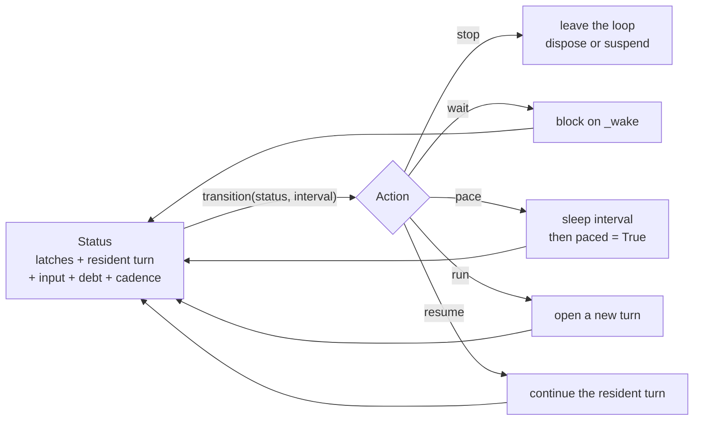
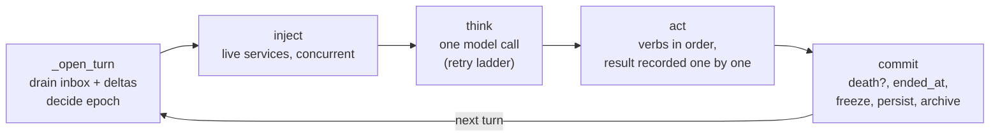
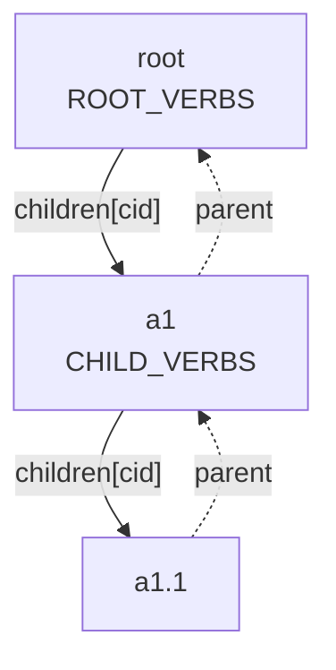
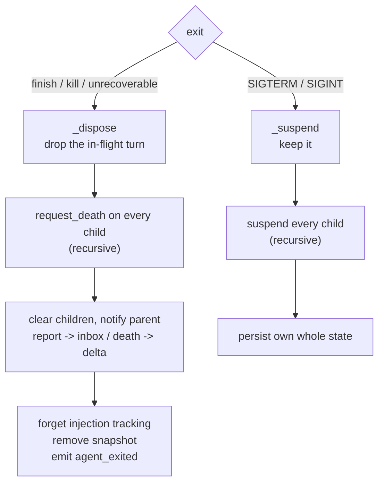
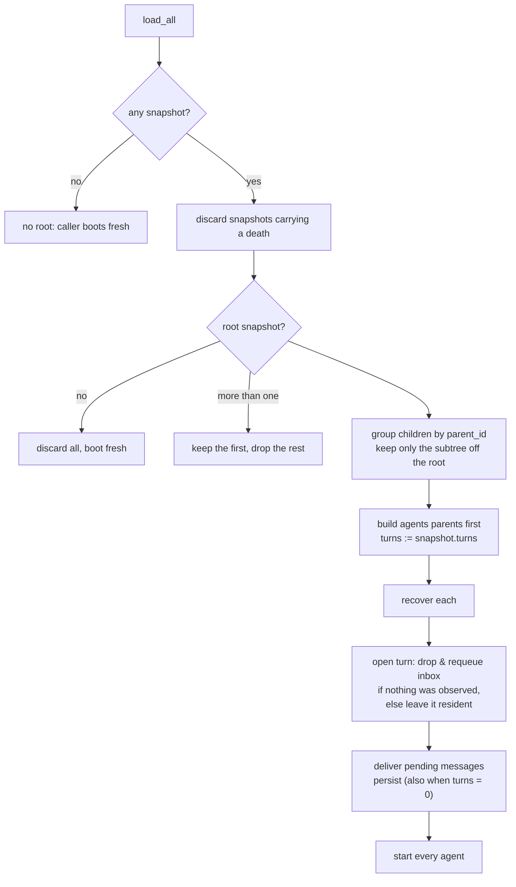
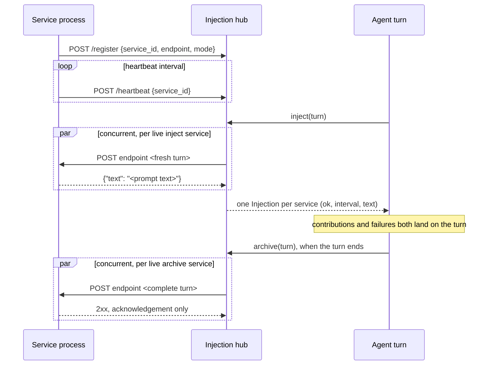
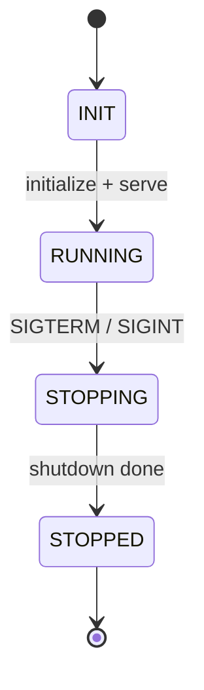

# Architecture

This document is the normative description of the core runtime. Every
statement names the module that enforces it. If the code and this
document disagree, one of them is a bug.

The core lives in `nan/`; service processes share
`lib/nan-service-kit`. The tree below shows the core modules and
follows the actual layout.

    nan/
    ├── app.py            composition root, process lifecycle
    ├── boot.py           boot restore (rebuild the tree)
    ├── events.py         process-wide event sink (singleton)
    ├── gateway.py        web UI: HTTP + WebSocket
    ├── agent/
    │   ├── core.py       the Agent loop, persistence, exits
    │   ├── control.py    Status -> Action (the loop's fold)
    │   ├── engine.py     the turn engine (one model call)
    │   ├── failure.py    one failure classification
    │   └── verbs/        spawn / sleep / shell / send / kill / finish
    ├── turn/
    │   ├── model.py      the Turn record
    │   └── render.py     deterministic prompt rendering
    ├── persistence/
    │   └── snapshot.py   per-agent snapshots
    ├── execution/
    │   └── sandbox.py    OS-level execution sandbox
    ├── llm/
    │   ├── provider.py   the model API transport
    │   └── types.py      protocol vocabulary (DTOs)
    ├── injection/
    │   ├── hub.py        registry + per-turn collection
    │   ├── client.py     the concurrent collector
    │   └── types.py      protocol shapes (ServiceEntry)
    ├── utils/
    │   ├── loopback.py   entry guard primitives
    │   └── autostart.py  boot scripts and process groups
    └── config/           pydantic-settings, YAML source

Two boundary facts are settled here rather than per module:

- **The provider stops at `provider.py`.** The DTOs in `nan/llm/types.py`
  are the provider-neutral protocol shapes (`Message`, `ToolCall`,
  `LLMResponse`, ...); the runtime stores and renders only these, and
  `provider.py` translates SDK objects into them, so no other module
  ever names an OpenAI or Anthropic type. The module imports nothing
  from `nan`, so importing it cannot create a cycle; it is imported as
  `nan.llm.types`, because the `nan.llm` package pulls the provider
  (only `app` wants that).
- **One wiring point.** `app.py` constructs the single `LLMProvider`;
  each `Agent` builds its own `TurnEngine` from it, so the agent runtime
  never depends on which provider is in use.

## Layers

The model is a layered core with adapters at the edge. Import arrows
point down only:

| # | Layer | Modules | May import |
| --- | --- | --- | --- |
| 6 | composition root | `app` | 0-5 |
| 5 | boot | `boot` | 0-4 |
| 4 | transports | `llm/provider`, `gateway` | 0-1 |
| 3 | runtime | `agent` (core / control / engine / failure / verbs) | 0-2, plus `LLMProvider` as a type only |
| 2 | called adapters | `persistence`, `execution`, `injection` | 0-1 |
| 1 | records | `turn` | 0 |
| 0 | vocabulary and infrastructure | `config`, `events`, `llm/types`, `utils` | nothing above |

An import that points up, or that lets a transport reach into the
runtime, is a bug. `settings` and `sink` are ambient: any layer may
read them, no layer writes them.

## One fact, one owner

Every runtime fact has exactly one owning unit, and exactly one rule
that writes it. This table is the ownership map; the sections below
give the rules.

| Unit | Owns | Written by |
| --- | --- | --- |
| `Agent.turns` | the conversation: every recorded turn | the agent's own turn task, at phases |
| `Turn.phase` | how far one turn has run | `engine` phases, `core._commit`, `close_interrupted` |
| `Turn.rendered` | the frozen message run of a turn | `render.freeze_turn`, exactly once |
| `Agent.parent` / `Agent.children` | the spawn tree (both directions of one edge) | `spawn_child`, `_dispose`, `restore` |
| `Agent._inbox` | messages delivered, not yet observed | `deliver`; drained only by `_open_turn` |
| `Agent._pending_deltas` | state-change lines not yet attached to a turn | `note_delta`; drained only by `_open_turn` |
| `Agent._death` | the exit record (first one wins) | `request_death` / `finish` / `_fail_turn` |
| `Agent._paused` / `_stopping` | the two process latches | `pause`/`resume`/`_park`; `suspend` |
| `Status` (derived) | everything the fold may read | `core._status`, recomputed each iteration |
| `AgentSnapshot` (one file per agent) | identity, turns, unobserved inbox | `Agent.persist` (the only writer) |
| Injection registry | live services and their modes | `InjectionHub` routes |
| Event ring | the live telemetry stream | `events.sink` |
| `settings` | every policy value and path | loaded once from YAML at import |

Two corollaries:

- The event stream is an observer, never a source. No runtime decision
  reads an event; the sink imports no domain module.
- Nothing infers progress from payload shape. Progress is `phase`;
  liveness is the tree; cadence is `paced`; open/closed is
  `phase != "committed"`.

## Invariants

Each invariant names the single place that keeps it true.

1. **One agent, one loop task.** An agent is one `asyncio.Task` running
   a loop that derives `Status`, folds it through `transition`, and
   performs the returned action (`core.loop`). There is no `if death` /
   `if paused` between awaits. An action that runs a turn runs it in
   one child task (`_turn_task`), which is the exact unit a pause
   cancels; only a pause cancel leaves the loop alive.
2. **The Turn list is the conversation.** `history` is a pure
   projection: the rendered messages of the turns in the last context
   epoch (`core.history`). No message is stored outside a `Turn`.
3. **`phase` is the only progress marker, and it is monotone**:
   `observed -> injected -> thought -> acted -> committed`
   (`turn/model.py`, advanced by `core._advance` / `engine`). A resumed
   turn continues from where its phase stands.
4. **A committed turn is frozen.** `rendered` is set once
   (`render.freeze_turn`) and never rewritten; a runtime fact that
   arrives after the commit goes to the pending channel instead
   (`core._note`).
5. **Verbs are at-most-once; only the model call retries.**
   `engine.act` records each result before the next call starts, and a
   turn resumed after `thought` closes what never reported as
   `INTERRUPTED` instead of re-running it (`core._continue`).
6. **Durability at four boundaries.** A turn is written at its intent,
   after the model answers, after each verb result, and at commit
   (`core.persist`, called in `_advance` / `_drive` / `_record_result` /
   `_commit`).
7. **Writes are atomic and whole-state.** Temp file + fsync +
   `os.replace`, one file per agent, never append
   (`SnapshotStore._write`).
8. **Identity belongs to the snapshot.** An agent exists as soon as its
   snapshot does; a snapshot with zero turns is a spawned agent that
   observed nothing yet (`AgentSnapshot`; `spawn_child`).
9. **The root never exits.** `ROOT_VERBS` has no `finish`; a root whose
   turn fails parks instead of dying (`core._fail_turn`).
10. **Death disposes, shutdown persists.** `_dispose` removes the
    snapshot and cascades death; `_suspend` rewrites it and cascades
    suspend (`core.loop`'s finalizer).
11. **Pause is one latch over the whole subtree.**
    `pause`/`resume` cascade over `children`, and a child spawned into
    a frozen tree is frozen (`core.pause`, `core.spawn_child`).
12. **An exit is announced exactly once.** A finish report rides the
    parent's inbox, a bare death rides its `<delta>` ledger, and the
    child slot is released in the same step (`core._dispose`).
13. **Snapshot writes never kill an agent.** `persist` is the one
    writer and swallows I/O errors: the last good snapshot stands
    (`core.persist`).
14. **Cross-task mutation is one synchronous step.** `deliver`,
    `note_delta` and the latches append or set without awaiting, so a
    drain cannot interleave with a delivery (`core.deliver`,
    `_begin_death`).

## Control flow



`Status` (`agent/control.py`) is derived, never stored:

| Field | True when |
| --- | --- |
| `death` | `_death` holds an exit record |
| `stopping` | `_stopping` was set by shutdown |
| `paused` | `_paused` was set by pause (or by a root's failed turn) |
| `open_turn` | the last turn exists and its phase is not `committed` |
| `owed_step` | the last committed turn called verbs and carries no death |
| `input_ready` | the inbox is non-empty |
| `paced` | the cadence token is earned (initial value: earned) |

`transition` is total and ordered; the first matching row wins:

| # | Condition | Action |
| --- | --- | --- |
| 1 | `death` or `stopping` | `stop` |
| 2 | `paused` | `wait` |
| 3 | `open_turn` | `resume` |
| 4 | `interval > 0` and `paced` | `run` |
| 5 | `interval > 0` and not `paced` | `pace` |
| 6 | `interval == 0` and (`input_ready` or `owed_step`) | `run` |
| 7 | otherwise | `wait` |

Behaviour that follows from the table alone:

- **Event-driven** (`interval == 0`): input opens a turn, and a turn
  that called verbs opens the next one so the model can read its
  results; otherwise the loop waits.
- **Interval-driven** (`interval > 0`): one turn per interval. Pending
  input never skips the interval, and `pace` is entered only after a
  turn has spent the token -- a resumed turn counts as a turn.
- **Pause** cancels the in-flight turn where it stands and parks the
  tree; a resume lifts it and the fold returns `resume`.
- **`wait`** clears `_wake` and awaits it in one synchronous step, so a
  delivery cannot slip between the status check and the block.

## The turn



`Turn` (`turn/model.py`) is a frozen dataclass and the only runtime
record. It is self-contained: identity (`agent_id` / `parent_id` /
`depth`), inputs (`inbox`, `injections`, `delta`), flow (`reply`,
`thinking`, `calls`, `results`, `llm`), exit (`death`), and its frozen
`rendered` run.

| Phase | Reached in | Adds | A resume from here |
| --- | --- | --- | --- |
| `observed` | `_open_turn` | identity, epoch, origin, inbox, deltas | re-runs inject and the model call |
| `injected` | `engine.inject` | service contributions, service deltas | re-runs the model call |
| `thought` | `engine.think` | reply, thinking, calls, `llm` | **never** re-runs a verb: unreported calls close as `INTERRUPTED` |
| `acted` | `engine.act` | one `ToolResult` per call | commit only |
| `committed` | `_commit` | `ended_at`, death if any, frozen `rendered` | terminal |

Persistence boundaries, per turn:

| Write | When | What is on disk |
| --- | --- | --- |
| 1 | before inject | the turn's intent: identity, inputs, epoch, persona marker |
| 2 | after the model answers | plus reply, thinking, calls, `LLMCall` |
| 3 | after **each** verb result | plus that result; a crash mid-batch loses only the call in flight |
| 4 | at commit | the complete, frozen turn |

A cancelled turn is parked where it stands (`_park_turn`); a failed
turn parks on the root and ends the child that owned it. Whatever
survives stays resident, so a later `resume` continues it from its phase.

`_open_turn` decides the context epoch: when the rendered history
exceeds `history_char_limit`, the turn list is cleared and the epoch
increments, so the next turn is `context_cleared`. `origin` is a wire
label (`first` / `normal` / `context_cleared`); behaviour reads
`epoch`. A persona content change is the one legal system-prompt
invalidation and rides the turn as `persona` (`_persona_for_turn`).

## Tree and exits



The edge is the only address, in both directions: `children[child_id]`
is the way down (`send` down, `kill`), `parent` is the way up (`send`
up, `finish` report). The sender names the edge, so the message kind is
decided at the sender (`InboxMessage.from_user` / `from_parent` /
`from_child`). A missing id is a verb error the model reads, never an
exception.

`spawn_child` is the whole birth protocol, in this order:

1. enforce `max_depth` / `max_children` (negative means unlimited);
2. create the child and register the edge in `children`;
3. deliver the task as the child's first inbox message;
4. note `+id spawned` in the parent's pending delta;
5. write the child's snapshot -- **durable before it runs**, a
   zero-turn snapshot is a live spawned agent;
6. pause it if the parent is frozen, then `start()`.

Step 6 runs in a `finally`: a pause or shutdown that cancels the spawn
mid-write still starts (frozen) children, so a registered child is
never a zombie.



- **Death** is `finish` (child only), `kill` (a child's subtree), and
  `unrecoverable` (a child's failed turn). The first `_death` wins;
  `request_death` is idempotent.
- **Shutdown** suspends: every agent persists its in-flight turn, no
  snapshot is removed, no notice is sent.
- **Pause** is a latch, not an exit: nothing dies, nothing is written
  except the parked turn, and a restart lifts it (it is process-scoped).

## The three channel types

A turn's observation is one rendered message built from three ordered
sections, each omitted when empty (`turn/render.py`):

| Channel | Holds | Written at | Lifetime |
| --- | --- | --- | --- |
| `delta` | system-state lines, grouped by section, order = first appearance | `note_delta` (pending), drained by `_open_turn` | transient between turns |
| `injections` | per-service contributions this turn, `ok=False` marks a failure | `engine.inject` | on the turn, durable |
| `inbox` | contentful messages: user input, parent messages, child sends and finish reports | `deliver`, drained by `_open_turn` | on the turn, durable |

The boundary is one sentence: **state changes ride `<delta>`; content
that a reader must read rides `<inbox>`**.

```
<delta>
<service>+echo online</service>
<subagent>+9d21 spawned</subagent>
</delta>

<injection>
<service id="echo">
contributed text
</service>
</injection>

<inbox>
<user>
hello
</user>

<subagent id="9d21" event="finish">
report text
</subagent>
</inbox>
```

A turn that observed nothing renders `(no input this turn)`; an
in-flight turn renders its observation alone. `render_turn` is a pure
function of the turn, so the same turn always renders to the same
bytes, and a failed service's body is prefixed with
`[service error] `.

Runtime facts about this agent that land outside a turn (a pause, a
failure, a `resumed` marker) go through `_note`: into the open turn
when there is one, otherwise into `_pending_deltas`, which the next
observation drains. A committed turn is never mutated, so a fact that
arrives after the commit waits for the next turn instead of
disappearing. A parent's view of its children (`+id spawned`,
`-id died`) is passive and always deferred (`note_delta`), so it
never interrupts a turn.

## Snapshot and restore

One JSON file per agent, named by `agent_id`
(`persistence/snapshot.py`):

```json
{
  "agent_id": "...",
  "parent_id": null,
  "depth": 0,
  "turns": [ ... ],
  "pending": [ ... ]
}
```

- `turns` may be empty; that is a spawned agent which never observed
  anything.
- `pending` is the inbox no turn has drained yet.
- `turns[].agent_id` must equal the snapshot's; a mismatch is a
  `ValueError`.
- The store skips an unreadable file, and skips a file whose snapshot
  id does not match its name; those agents cannot come back.
- Death removes the file (`_dispose`); shutdown rewrites it
  (`_suspend`).

Boot (`boot.py`), after the sink was reset for this boot:



An agent whose depth disagrees with the tree it hangs off keeps the
tree's depth (a warning is logged): the tree is the authority, the
snapshot's depth is a hint. A snapshot whose parent has no snapshot is
an orphan and is discarded, so the live tree is always exactly the set
of snapshots reachable from the root.

## Failure vocabulary

`classify` (`agent/failure.py`) answers one question -- may this
step run again? -- with three answers: `cancelled` (the control path
owns it), `retryable` (429, 5xx, transport timeouts, broken streams),
`fatal` (no retry can repair it). It is the only place a failure is
classified.

- **Only the model call retries**, along `settings.agent.backoff`.
  A retry re-runs the same turn's call and counts up `LLMCall.retries`.
- **A verb never fails a turn.** A throwing verb returns its error as
  that call's result (`_run_call`), so the model can correct it.
- **An exhausted ladder is `Unrecoverable`**: a child dies
  (`unrecoverable: <reason>`), the root parks.
- **A pause or shutdown cancel is not a failure.** It parks the turn
  (pause) or persists it (shutdown); only the control path reads it.

Telemetry and record both exist and never conflict: `verb_done` carries
a live `duration_s`, the turn carries the authoritative `ToolResult`
interval; `turn_done` carries usage and latency, `LLMCall` is the
record. Where both exist, the turn wins.

## Injection protocol



- Registration, heartbeat, unregister and `/services` are
  loopback-only in both directions (entry guard + endpoint check).
- `inject` services receive the fresh turn shape (`to_fresh_json`: no
  reply, calls, results, llm, death, rendered) before every prompt
  assembly; their text lands on the turn and an empty contribution is
  dropped.
- `archive` services receive the complete turn once it ends; their
  reply is an acknowledgement and a failed delivery is logged and
  dropped.
- A service that stops beating is evicted at the next read (TTL), and
  the per-agent online/offline delta is diffed against that agent's
  last boundary (`InjectionHub._live_services`, `_service_delta`).

## Events

`sink` (`events.py`) is the process-wide singleton. Every event
carries the envelope `t` / `id` / `seq` / `ts` / `boot_id` plus a
`content` object; an event with no `agent_id` has no agent context.

| `t` | Content | Emitted by |
| --- | --- | --- |
| `agent_started` | `agent_id`, `depth`, `parent_id`, `pacing` | `Agent.loop` |
| `agent_paused` / `agent_resumed` | `agent_id` | `_park` / `resume` |
| `agent_exited` | `agent_id`, `reason`, `report` | `_dispose` |
| `turn_started` | `agent_id`, `turn_index`, `inbox_count` | `_advance` |
| `turn_done` | `agent_id`, `turn_index`, `usage`, `latency_s`, `retries`, `calls`, `history_chars` | `_commit` |
| `turn_interrupted` | `agent_id`, `turn_index`, `reason` | `_continue` / `_fail_turn` |
| `turn_failed` | `agent_id`, `error`, `backoff_s`, `retry_index` | `_think` |
| `injections_collected` | `agent_id`, `services[]` (`service_id`, `ok`, `duration_s`, `text_len`) | `engine.inject` |
| `thinking_started` / `thinking_delta` / `thinking_done` | stream `id`, `text` (delta), `agent_id`, `depth` | `engine.generate` |
| `output_started` / `output_delta` / `output_done` / `output_cancelled` | stream `id`, `text` (delta), `agent_id`, `depth` | `engine.generate` |
| `verb_started` | `agent_id`, `verb`, `arguments` | `_run_call` |
| `verb_result` | `agent_id`, `verb`, `text`, optional `detail` | `_run_call` |
| `verb_done` | `agent_id`, `verb`, `duration_s` | `_run_call` |
| `verb_failed` | `agent_id`, `verb`, `error{type,message}` | `_verb_error` |
| `snapshot_restored` | `agent_id`, `parent_id`, `depth`, `turns`, `in_flight` | `restore._recover` |
| `user_input` | `text`, optional `mid` | `Core._ingest` |

The sink keeps a bounded ring (`HISTORY_LIMIT`), where streaming
deltas are coalesced into one entry per stream, and fans out to
subscriber queues that drop their oldest entry when full. Nothing
reads the ring back into a decision.

## Gateway

The gateway (`gateway.py`) is transport only: it formats the event
stream for the web UI and carries input back to the root's inbox.

- `ws://host:port/ws`: on connect, `hello` (`{t, seq, content: {boot,
  model, paused}}`), then the surface table, then the history ring.
- Inbound: `{"t":"input","text","mid"}` deduplicated by `mid` in a
  bounded cache -> `on_input`; `{"t":"pause"}` / `{"t":"resume"}` ->
  `on_pause`; `{"t":"ping"}` -> `pong`.
- Surfaces: `POST /surfaces` is a heartbeat (same spec refreshes,
  changed spec updates in place), `DELETE /surfaces/{id}` withdraws;
  the reaper drops entries whose heartbeat stopped.
- Inputs and pause are dropped unless the core is `RUNNING`.
- Every entry point is loopback-guarded (see
  [SECURITY.md](../../SECURITY.md)); panel urls must be loopback.

## Core lifecycle



`Core.run` (`app.py`):

1. `_initialize`: build provider / hub / sandbox, create the workspace,
   `sink.reset(boot_id)`, load snapshots, `restore` (or build a fresh
   root when nothing is on disk).
2. `_serve`: start the hub (the socket must be bound), start autostart
   scripts, start the root if restore did not, start the gateway,
   install signal handlers, `RUNNING`.
3. `_wait_for_stop` waits for the stop event or the gateway exiting; a
   gateway exit is logged and the core keeps serving.
4. `_shutdown` is `STOPPING`: `root.suspend()` **synchronously** (so the
   snapshot is written before the first await), then await the root
   task with a 10s budget (cancel, 10s again), then stop autostart,
   close the gateway, stop the hub, close the provider, remove the
   signal handlers, `STOPPED`.

Each step is best-effort and logged: one failing component never
prevents the rest of the shutdown.

## What a stop or a crash can lose

Durable: committed turns, every verb result recorded before the stop,
every agent's identity, and the tree as of the last writes. The
remaining gaps are closed and enumerated:

| Event | What is lost | What is never lost |
| --- | --- | --- |
| Pause | nothing (the parked turn is persisted) | turns, inputs, tree |
| Graceful stop (SIGTERM/SIGINT) | undrained `<delta>` lines only | turns, inbox, tree, identity |
| Crash before write 1 | inputs delivered since the agent's last write; undrained `<delta>` lines | the previous turn list |
| Crash during the model call | the call's token cost; the call is re-issued on restore | the turn's inputs |
| Crash mid-act | the call in flight (closed as `INTERRUPTED`, never re-run) | every result already recorded |
| Crash after commit, before archive | the archive delivery (an observer; it is logged and dropped anyway) | the committed turn |
| Crash after a child's report, before the parent's next write | that one report | the child's death (its snapshot is gone; the tree is consistent) |
| Crash between a spawn and the child's write | the spawn intent (the parent's turn is requeued or closed interrupted) | a false child: a claim can only be committed after the child's write |
| Crash between the child's write and the spawn's result | the child id in the parent's turn (it closes `INTERRUPTED`) | the child itself: it is restored and runs its task |

`<delta>` is deliberately not durable: it is the live ledger that
re-renders itself from what happens next (a dead child is gone from the
tree; a service that comes back re-announces itself). Every durable
fact lives on a `Turn`.
