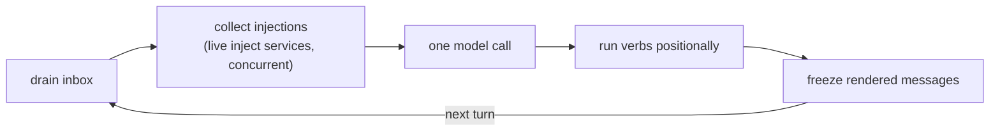
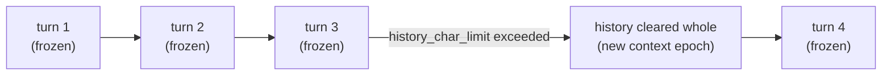
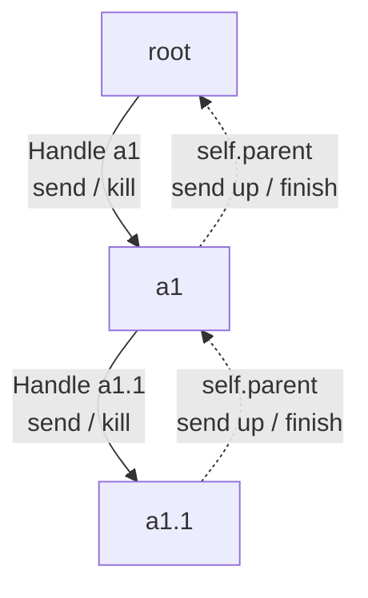
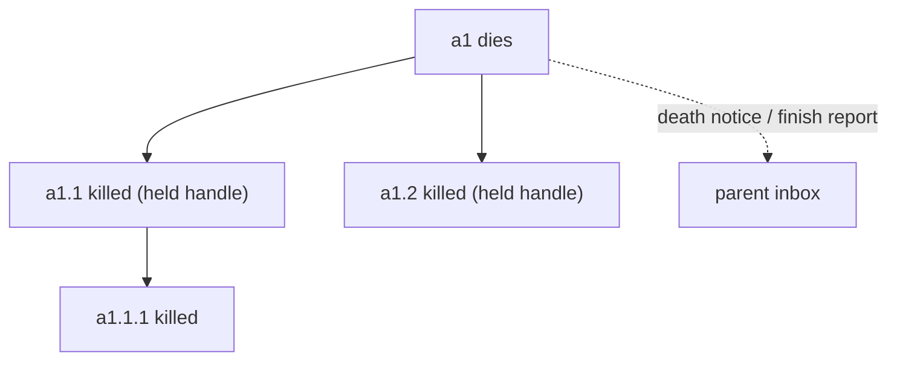
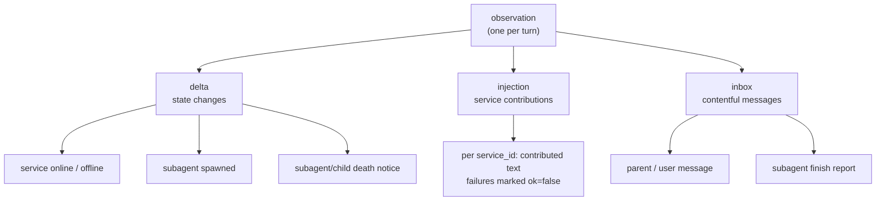
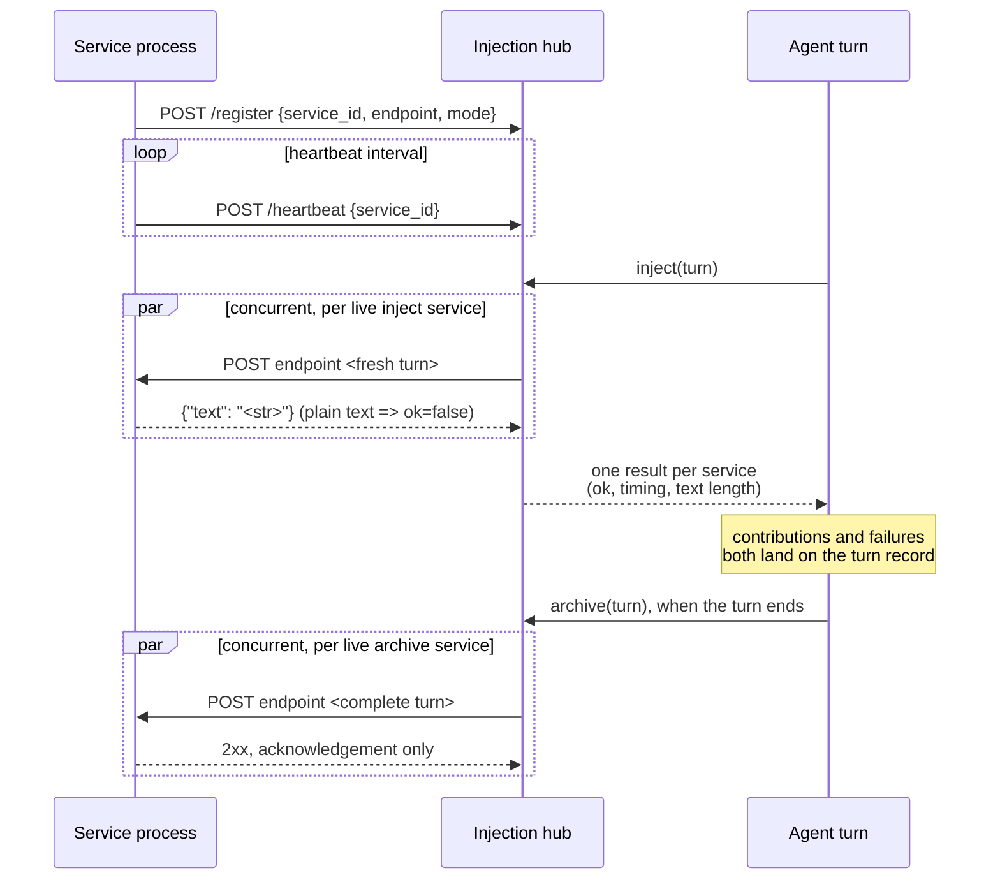
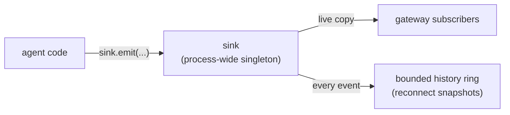

# Architecture

The core runtime lives in `nan/`; service processes share
`lib/nan-service-kit`. The tree below shows the core modules and
follows the actual layout.

    nan/
    ├── app.py            composition root
    ├── events.py         process-wide event sink (singleton)
    ├── gateway.py        web UI: HTTP + WebSocket
    ├── agent/
    │   ├── core.py       the Agent loop
    │   ├── engine.py     the turn engine (one model call)
    │   ├── handle.py     Handle + Book
    │   ├── sandbox.py    OS-level execution sandbox
    │   └── verbs/        spawn / sleep / shell / send / kill / finish
    ├── turn/
    │   ├── model.py      the Turn record
    │   └── render.py     frozen prompt rendering
    ├── llm/
    │   ├── provider.py   the model API transport
    │   └── types.py      protocol vocabulary (DTOs)
    ├── injection/
    │   ├── hub.py        registry + per-turn collection
    │   └── client.py     the concurrent collector
    ├── utils/
    │   ├── loopback.py   entry guard primitives
    │   └── autostart.py  boot scripts and process groups
    └── config/           pydantic-settings, YAML source

Any domain may import the DTOs in `nan/llm/types.py`. The
composition root constructs one `LLMProvider` (the transport edge),
and the turn engine is the module that calls it. The agent runtime
stays independent of which provider is in use.

## One agent, one task

An Agent is a single asyncio task running turns in a loop. The
loop paces itself with `autonomous_interval`: above zero, each turn
is followed by a sleep of that length; at zero, the loop waits for
inbox input, and a turn that called verbs runs again so the model can
read the results. Messages queue in the inbox and drain at the next
turn boundary.

## The turn

A turn is the unit of record. `Turn` holds the inbox drained
into it, the injections collected, the delta lines, and the
model's reply -- the complete runtime log. The event stream
exposes the same facts live, and the turn is where they persist.

The rendered prompt is frozen on first render and later turns
append to it. History is add-only, so unchanged turns stay
byte-stable and cache-friendly for the model's prompt prefix.
Assistant messages carry the model's reasoning (thinking blocks,
signatures included) so the adapter can replay it verbatim; the
prefix cache stays valid and Anthropic/OpenRouter keep the
signed reasoning across turns. When the history exceeds
`history_char_limit`, the whole history is cleared and a new
context epoch begins.

## Handles: the multi-agent graph

Solid edges are handles (downward, full authority); dotted
edges are the parent reference a child uses to talk upstream,
which carries no control right over the parent.

A Handle is a cross-agent channel plus the control right over
one agent:

- bound to exactly one target and one holder, the spawner. The
  composition root holds the root agent directly and feeds it
  through `receive_up`; every child is reached through a handle
- owned by its spawner, so the cascade-death graph follows the
  spawn tree
- through it the holder may `send()` into the target's inbox
  and `kill()` the target; the target replies upstream through
  its parent reference

The `Book` is the process-wide id -> agent registry; routing
goes through handles, and whole-tree shutdown starts at
`root.request_death` and follows the cascade. When an agent
dies it tears down everything it holds (cascade), then a finish
report goes to its parent's inbox; a bare death becomes a
`parent.note_delta` line in `<delta>`.

## Verbs

The six cognitive actions: `spawn`, `sleep`, `shell`, `send`,
`kill`, `finish` (root has no finish). Tools and skills are plain
files the agent reaches through `shell` inside the sandbox.

Before a command is wrapped, it passes the `sandbox.deny` rules: a
regex hit returns the rule's `reason` to the model as the shell
result, and the command does not run.

## Observations

Each turn the agent sees one structured observation:

    <delta>      state changes (services online/offline,
                 subagent spawns, ...), grouped by first
                 appearance
    <injection>  contributions from external services, labelled
                 by service_id
    <inbox>      parent/user messages and subagent finish notices

The boundary: state changes ride `<delta>`, contentful messages
ride `<inbox>`.

## Injection

Services are independent processes registered with the hub
(see for-service-authors/injection-service.md). Each entry
declares a mode: `inject` entries receive the fresh Turn before
every prompt assembly and their text lands on the turn record;
`archive` entries receive the complete Turn once it ends and
their reply is an acknowledgement. Both modes feed the service
online/offline delta.

## Events

`nan.events.sink` is a process-wide singleton (loguru-style):
agent code emits through `sink.emit`, and the gateway subscribes
on its own. Every event also enters a bounded history ring, which
supplies the snapshot a client receives on reconnect. Modules
receive the sink as an argument or import it directly.

## Gateway

The gateway formats the event stream for the web UI and carries
user input back to the root agent's inbox. It owns the surface table
and the input dedup cache; agent semantics stay with the runtime.
It binds loopback and checks Host/Origin on entry (see
[SECURITY.md](../../SECURITY.md)).
