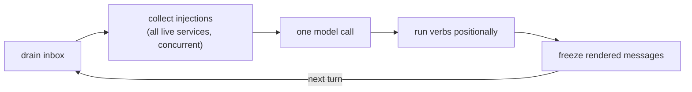
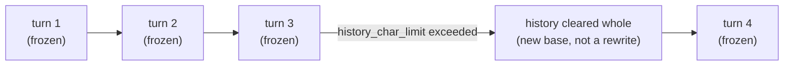
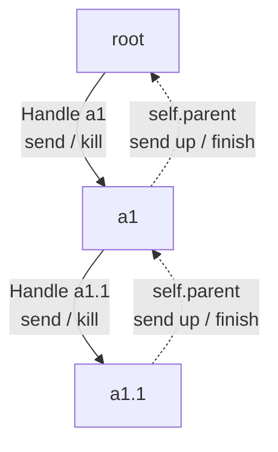
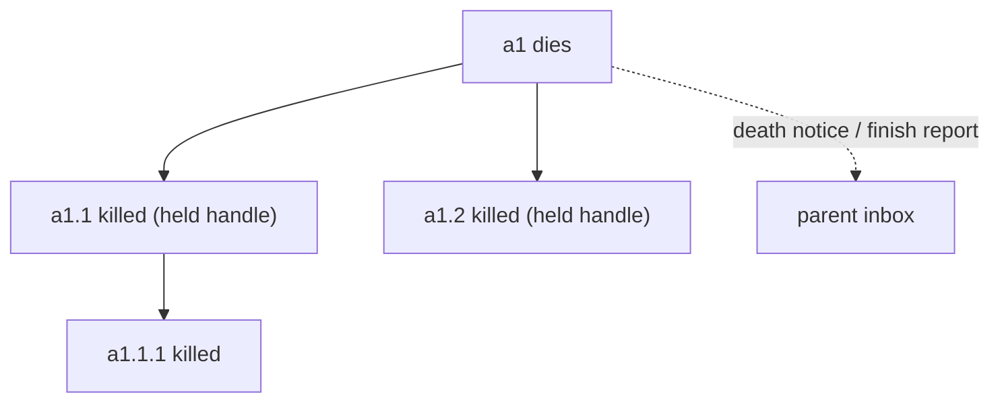
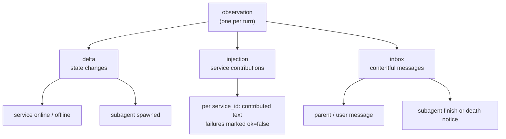
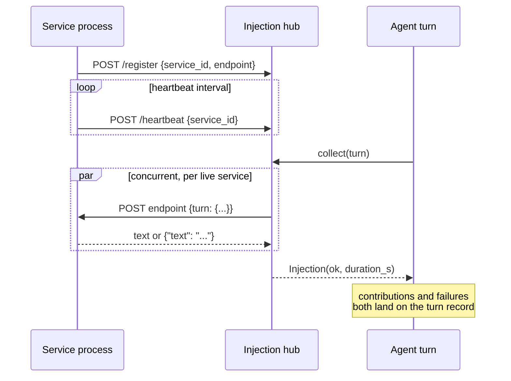
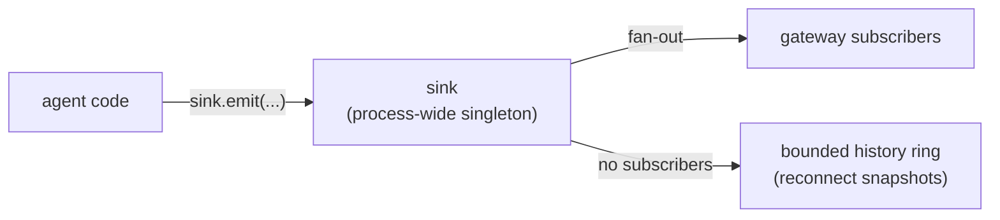

# Architecture

One runtime package, `nan/`. Every module below is a real file
in it; this document follows the actual layout.

    nan/
    ├── app.py            composition root
    ├── events.py         process-wide event sink (singleton)
    ├── gateway.py        web UI: HTTP + WebSocket
    ├── agent/
    │   ├── core.py       the Agent loop
    │   ├── engine.py     the turn engine (one model call)
    │   ├── handle.py     Handle + Book
    │   ├── sandbox.py    OS-level execution sandbox
    │   └── verbs/        spawn / sleep / shell / send / kill / finish
    ├── turn/
    │   ├── model.py      the Turn record
    │   └── render.py     frozen prompt rendering
    ├── llm/
    │   ├── provider.py   the only module that talks to model APIs
    │   └── types.py      protocol vocabulary (DTOs)
    ├── injection/
    │   ├── hub.py        registry + per-turn collection
    │   └── client.py     the concurrent collector
    └── config/           pydantic-settings, YAML source

## One agent, one task

An Agent is a single asyncio task running turns in a loop. The
loop paces itself with `autonomous_interval` (or waits for input
when it is 0). Messages never interrupt an in-flight turn: they
queue in the inbox and drain at the next turn boundary.

## The turn

A turn is the unit of record. `Turn` holds the inbox drained
into it, the injections collected, the delta lines, and the
model's reply -- a complete runtime log with no separate trace
facility. The rendered prompt is frozen on first render and
never recomputed: history is add-only, so unchanged turns are
byte-stable and cache-friendly for the model's prompt prefix.
When the history exceeds `history_char_limit` it is cleared
whole -- a reset, not a rewrite.

## Handles: the multi-agent graph

Solid edges are handles (downward, full authority); dotted
edges are the parent reference a child uses to talk upstream
(no handle, so a child cannot kill its parent).

A Handle is a cross-agent channel plus the control right over
one agent:

- bound to exactly one target and one implicit holder (the
  spawner; the root's handle is held by the composition root)
- not transferable: the cascade-death graph is exactly the
  spawn tree
- through it the holder may `send()` into the target's inbox
  and `kill()` the target; the target replies upstream through
  its parent reference

The `Book` is the process-wide id -> agent registry used for
routing, status snapshots and whole-tree shutdown. When an agent
dies it tears down everything it holds (cascade), then its
parent's inbox receives a finish report or a death notice.

## Verbs

The six cognitive actions: `spawn`, `sleep`, `shell`, `send`,
`kill`, `finish` (root has no finish). Tools and skills are not
verbs -- they are plain files the agent reaches through `shell`
inside the sandbox.

## Observations

Each turn the agent sees one structured observation:

    <delta>      state changes (services online/offline,
                 subagent spawns, ...), grouped by first
                 appearance
    <injection>  contributions from external services, labelled
                 by service_id
    <inbox>      parent/user messages and subagent finish notices

The boundary: state changes ride `<delta>`, contentful messages
ride `<inbox>`.

## Injection

Services are independent processes registered with the hub
(see for-service-authors/injection-service.md). Before every
prompt assembly the hub POSTs the new Turn to every live service
concurrently; contributions, failures and timeouts all land on
the turn record.

## Events

`nan.events.sink` is a process-wide singleton (loguru-style):
agent code only *emits* (`sink.emit`), the gateway subscribes on
its own; with no subscribers events simply land in a bounded
history ring for reconnect snapshots. Nothing is wired by
reference.

## Gateway

The gateway formats the event stream for the web UI and carries
user input back to the root agent's inbox. It owns nothing about
agent semantics. Loopback-only with a Host/Origin entry guard
(see for-users/security.md).
