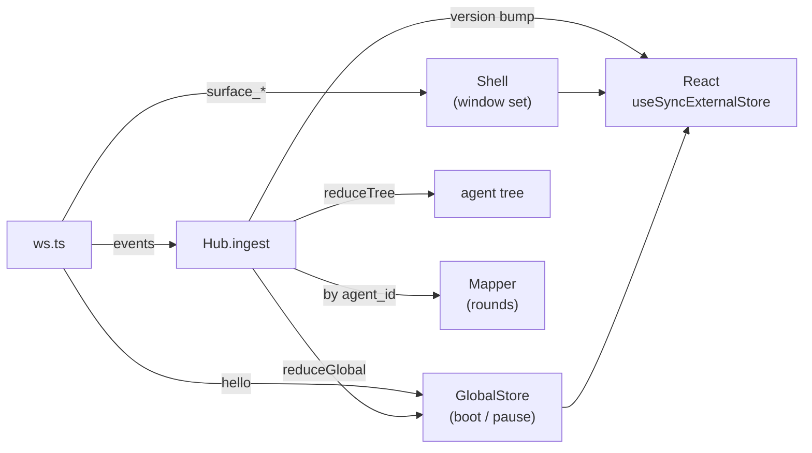

# Frontend architecture

[frontend-protocol.md](frontend-protocol.md) is the contract: what
arrives on the socket and what the desktop may send back. This
document is the other half -- how the renderer consuming that
stream is laid out, which module owns which state, and which
invariants hold the renderer together.

The frontend has no build-time knowledge of the agent. It imports
nothing from `nan/`, never infers a turn, and never stores a reply.
Everything on screen arrived as an event.

## Layout

    frontend/src/
    ├── main.tsx          composition root: store, hub, transport, react root
    ├── transport/        the upstream channel
    │   ├── ws.ts         WebSocket client: hello, replay, reconnect, ping
    │   └── mock.ts       scripted stream behind ?mock
    ├── kernel/           state over plain data: no React, no DOM
    │   ├── protocol.ts   envelope types, guards, field readers
    │   ├── store.ts      connection, boot, root pause, model
    │   ├── agents.ts     agent tree: identity, status, turn count
    │   ├── queue.ts      window order + the one active window
    │   └── history/
    │       ├── hub.ts    the single ingest path; routing to mappers
    │       ├── mapper.ts one agent's events folded into rounds
    │       └── parts.ts  the renderable part types
    ├── shell/            chrome: pane, rail, footer, theme
    └── surfaces/         the two window kinds
        ├── registry.tsx  window ids, icons, the builtin window
        ├── agent/        the built-in agent pane
        └── service/      iframe sandbox for a service panel

## Dependency direction

- `kernel/` imports nothing from `shell/`, `surfaces/` or
  `transport/`. It is reducers and lookups over plain objects, so
  `frontend/tests/` runs them under vitest with no DOM.
- `transport/` imports `kernel/` (protocol + hub) and reports
  connection state through `GlobalStore`. It never imports
  `shell/`.
- `surfaces/` imports `kernel/` types and window shape. It knows
  nothing of the transport, and nothing of the queue.
- `shell/` imports `kernel/`, `surfaces/` and the `Transport`
  interface. Together with `surfaces/`, it is one of the two
  React layers.

`main.tsx` wires the three in one direction: `GlobalStore` ->
`Hub` -> transport, and `Shell` subscribing to both.

## State ownership

| State | Owner |
|---|---|
| connection, boot id, last applied seq, root id, root pause, model | `GlobalStore` |
| agent tree (depth, parent, status, turns) | `Hub.tree` / `agents.ts` |
| one agent's transcript (rounds, parts) | one `Mapper` per agent |
| window order + active window | `queue` state held by `Shell` |
| theme | `Shell`, persisted in `localStorage` |

React holds copies of exactly two things: the window set and the
theme toggle. The transcript is never mirrored into component
state; components read the hub on the version counter that the hub
bumps after each ingest.

## Data flow

1. `transport/ws.ts` parses the frame, drops anything that is not
   `hello` or an envelope, and handles `surface_added` /
   `surface_removed` itself -- these are live state, not history.
2. `hello` updates boot / model / pause. A changed boot calls
   `hub.reset()`, voiding tree and timelines.
3. Everything else enters `Hub.ingest`: tree and global state
   first, then the event goes to the mapper of its `agent_id`.
4. Each mapper notifies the hub, the hub bumps its version, and
   `useSyncExternalStore` re-renders the subscribers.

## Invariants

- **Seq is the only cursor.** Events at or below the last applied
  seq are dropped. `hello.seq` is not adopted as the cursor:
  replay may contain lower seqs.
- **Boot change voids history.** The tree, mappers and pending
  buffer are rebuilt from the replay that follows the new hello.
- **Root identity is learned, never assumed.** The first
  `agent_started` at depth 0 sets it; any event carrying depth 0
  is a fallback when that event was evicted from the ring. Until
  the root is known, events go into a 64-entry buffer and are
  back-filled in order.
- **`user_input` belongs to the root.** It carries no `agent_id`
  by design, so it bypasses agent routing and is fed to the root
  mapper.
- **One content slot.** `queue.order` is the rail and never
  reorders; registration appends and never steals the slot;
  closing empties the workspace without destroying the window;
  unregistering truly removes it.
- **Memory is bounded.** Exited agent nodes are capped at 512,
  exited timelines at 16, and the agent being viewed is pinned
  so its transcript survives its own exit.
- **The kernel is pure.** Reducers return the same reference when
  nothing changed, so a duplicate or unknown event does not wake
  subscribers.
- **Panels are opaque.** See below.

## Windows and panels

The agent pane is the built-in window (`kind: "agent"`); every
service adds one window through registration (`kind: "service"`).
The agent pane renders the hub's rounds for whichever agent the
breadcrumb has drilled into; the drill-down target lives in
`Shell`, not in the queue.

A service panel is an iframe with `sandbox="allow-scripts
allow-forms"` and a permissions policy that denies camera,
microphone, clipboard and fullscreen. Consequences, all
intentional:

- The panel has an opaque origin. Its requests to the gateway
  carry `Origin: null`, which the gateway's entry guard rejects;
  its WebSocket handshake is rejected the same way. The panel
  reaches its own backend, and that backend is what registers the
  surface.
- One message crosses the boundary: the desktop posts
  `{type: "nan:theme", theme}` to the panel on load and on every
  switch. No tokens, no state, no other traffic.
- The panel owns its palette; the message only selects one, and a
  panel never switches theme on its own. Opened outside the desktop,
  it falls back to `prefers-color-scheme`.

## Layout

Every pane hands its surface the size the pane actually has: the
frame is 100% by 100% and nothing is scaled, so a surface lays out
in real CSS pixels and adapts with ordinary CSS. Only the chrome
(pane header, rail, footer) carries sizes of its own.

## Build, dev, test

    cd frontend
    npm install
    npm run dev     # vite; proxies /ws to 127.0.0.1:8765
    npm run build   # tsc --noEmit && vite build -> dist/
    npm test        # vitest over kernel, agents, queue, history

The dev proxy rewrites the `Origin` header to the gateway's own
address, since the dev server's origin would otherwise fail the
entry guard. In production the gateway serves `dist/` itself, so
the page and the socket share one loopback origin.

`?mock` swaps in `MockTransport` (a scripted stream, no core
process); `?ws=ws://host:port/ws` overrides the socket URL for
reverse proxies.
