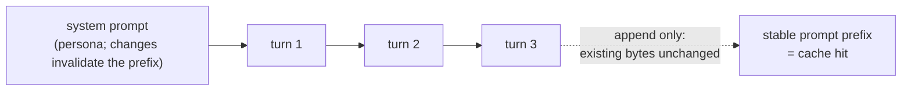
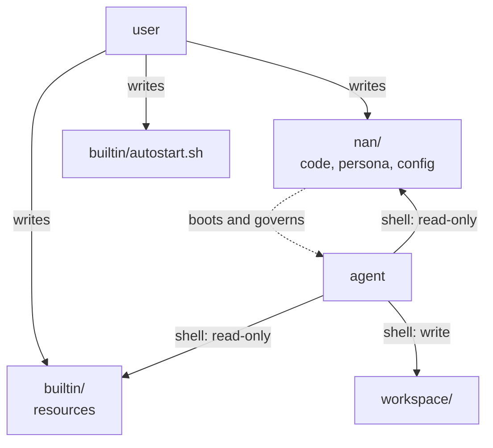

# Principles

The design rules the codebase is written against. When a change
feels ambiguous, these decide.

## Glossary

One name per concept. The aliases noted in the last column are
transport or prompt labels and stay as they are.

| Term | Meaning | In code |
| --- | --- | --- |
| Agent | one independent loop, root or child | `Agent` |
| root / child | agent without / with a parent | `parent is None`; `ROOT_VERBS` / `CHILD_VERBS` |
| Turn | one observation -> one model call -> verb run | `Turn` |
| Phase | where a turn stands | `TurnPhase`: observed -> injected -> thought -> acted -> committed |
| Epoch | one continuous context; cleared when history outgrows the limit | `Turn.epoch`, `origin="context_cleared"` |
| Observation | the per-turn user message built from delta / injection / inbox | `render._observation_message` |
| Inbox | messages delivered, not yet observed | `InboxMessage`, `Agent._inbox` |
| Delta | system-state lines (services, children, pause/resume) | `DeltaEvent`, `note_delta`, `_record_delta` |
| Injection | service prompt contributions for this turn | `Injection` |
| Archive | whole-turn record sent to a service after commit, never written back | `mode="archive"` |
| Verb | an action the model may call | `Verb`, `VerbCall`, `VerbResult`, `VerbDefinition` |
| Death | terminal record: reason + optional finish report | `Death` |
| Suspend | silent save on shutdown, not a death | `Agent.suspend`, `Status.suspend` |
| Surface | a service's panel in the front end | `/surfaces`, `Gateway._surfaces` |
| Sink | the in-process event bus | `events.sink` |

Wire/prompt aliases that stay: `<parentagent>` / `<subagent>` tags,
the delta section `subagent`, and the model API's `tools` /
`tool_calls`.

## Shell-first

The model already knows the shell. Tools, skills, data
processing, service management -- all of it is reachable through
`shell`. New capabilities are added by writing files into
`builtin/` (read-only resources) or `workspace/` (agent-writable).

## Import direction

The runtime module graph is acyclic and points downward: a module
imports from its own package or a lower layer. `TYPE_CHECKING` blocks
are the one place a module may name a type from above.

    app.py               composition root
    ├── gateway          HTTP + WS; formats the stream, owns no agent state
    ├── injection        registry + per-turn collection
    └── agent            loop, turn engine, verbs, spawning, sandbox
        ├── execution    sandbox + background jobs
        ├── persistence  snapshot store
        ├── turn         the Turn record and prompt rendering
        ├── llm          DTOs (types.py) + transport (provider.py)
        ├── config       Settings schema + YAML source
        ├── events       sink singleton
        └── utils        loopback policy

The layers, bottom up:

1. **Leaves.** `events.py`, `utils/loopback.py`,
   `config/models.py`, `llm/types.py` import nothing else from
   `nan`. Any layer may import these.
2. **Runtime infrastructure.** `config` (the schema; the
   composition root builds the one `Settings` instance) and
   `events` (the process-wide sink) are imported by every layer and
   import only downward.
3. **Model layer.** `llm/provider.py` imports `config` and
   `llm/types`. `app.py` constructs it, and `agent/engine.py`
   makes the calls. `turn/` reads DTOs from `llm`; the dependency
   runs one way, from `turn` to `llm`.
4. **Agent.** `agent/` imports `config`, `events`, `llm`, `turn`,
   `execution` and `persistence` (the last two are lower layers). It does not import `gateway`,
   `injection` or `app`: the injection hub arrives as a constructor
   argument and is named only under `TYPE_CHECKING`.
5. **Injection.** `injection/` imports `config`, `turn` and
   `utils/loopback`. Delivery leaves as an outbound HTTP call,
   and the agent loop pulls results from the hub; the dependency
   stays outside `agent/`, `gateway/` and `app`.
6. **Gateway.** Imports `config`, `events` and `utils/loopback`.
   It broadcasts what the sink carries and stays independent of
   the agent runtime and the injection registry, which keeps the
   web layer replaceable.
7. **Composition root.** `app.py` is the only module that
   imports `agent`, `injection` and `gateway` together, and the
   only one that constructs `LLMProvider`, `Sandbox`, `Gateway`
   and `InjectionHub`. Nothing imports `app`.

Three rules cover the cases that do not fit the ladder:

- **Type-only cycles** go inside `if TYPE_CHECKING:` with
  `from __future__ import annotations`. Current pairs:
  `verbs` -> `core`, `agent/core` -> `injection`,
  `boot` -> `injection`. A cycle needed at
  runtime points at the ownership boundary: redraw it rather than
  defer the import.
- **Intra-package loading order.** `agent/verbs/__init__.py`
  imports the six verb classes inside `_build_registry()`, after
  `Verb` and `VerbOutcome` exist. Verb modules import the
  package only.
- **Package re-exports.** `nan/llm/__init__.py` exports the DTOs
  and the provider, so `from nan.llm import Message` also loads
  `provider` and `config`. A module that wants only DTOs imports
  `nan.llm.types`.

## The turn is the record

Everything that happened in a turn -- inbox drained, injections
collected, deltas observed, the reply -- lives on the Turn.
LLM calls are metered on the record (`LLMCall`: model, usage,
started_at/ended_at, finish_reason, retries).

## Add-only context

Rendered turns freeze on first render; later turns append.
History grows by appending, and when the char limit trips it
clears whole and starts a new context epoch. Unchanged prefixes
stay byte-stable, which is what makes prompt caching work.

## Core files vs agent territory

Three zones: the nan package (core code and persona, kept
read-only to the agent) with `config/`, `builtin/` (read-only
resources), and `workspace/` (the agent's writable territory,
including its own boot script `workspace/autostart.sh`). The user's
boot script lives in `builtin/` and runs outside the sandbox; the
agent's one runs inside it.

## One path for everything important

Death has one path (finish or kill, both through the same
teardown). Configuration has one source (the YAML). Event flow
has one singleton (sink). Keeping one path per job avoids the
drift that comes with parallel mechanisms.

## Loud failure

A missing persona fails startup. A failed turn is retried on
the backoff ladder and every failure is recorded. A sandbox
missing its tooling warns loudly, or refuses to start when
`sandbox.required` is true. Breakage surfaces at the point it
happens.
