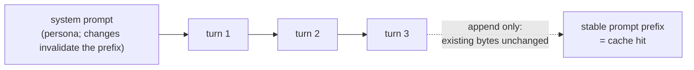
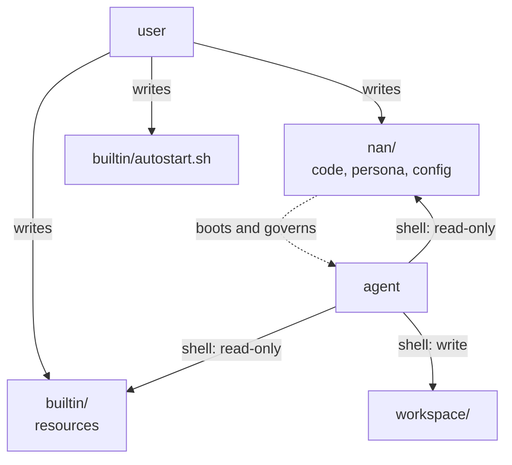

# Principles

The design rules the codebase is written against. When a change
feels ambiguous, these decide.

## Shell-first

The model already knows the shell. Tools, skills, data
processing, service management -- all of it is reachable through
`shell`. New capabilities are added by writing files into
`builtin/` (read-only resources) or `workspace/` (agent-writable).

## Import direction

The runtime module graph is acyclic and points downward: a module
imports from its own package or a lower layer, never from a layer
above it. `TYPE_CHECKING` blocks are the one place a module may
name a type from above.

    app.py               composition root
    ├── gateway          HTTP + WS; reads the sink, owns no runtime state
    ├── injection        registry + per-turn collection
    └── agent            loop, turn engine, verbs, handles, sandbox
        ├── turn         the Turn record and prompt rendering
        ├── llm          DTOs (types.py) + transport (provider.py)
        ├── config       settings singleton
        ├── events       sink singleton
        └── utils        loopback policy

The layers, bottom up:

1. **Leaves.** `events.py`, `utils/loopback.py`,
   `config/models.py`, `llm/types.py` import nothing else from
   `nan`. `agent/handle.py` belongs here too: its `Agent`
   reference is type-only. Any layer may import these.
2. **Singletons.** `config` (reads `config/nan.yaml` at import)
   and `events` (builds the sink) are imported by every layer and
   import nothing upward. They are the only modules carrying
   import-time state.
3. **Model layer.** `llm/provider.py` imports `config` and
   `llm/types`, and is called only from `agent/engine.py` --
   `app.py` is where it is constructed. `turn/` reads DTOs from
   `llm`; `llm` never imports `turn`.
4. **Agent.** `agent/` imports `config`, `events`, `llm`, `turn`.
   It does not import `gateway`, `injection` or `app`: the
   injection hub arrives as a constructor argument and is named
   only under `TYPE_CHECKING`.
5. **Injection.** `injection/` imports `config`, `turn`,
   `utils/loopback`. It does not import `agent`, `gateway` or
   `app`: delivery is an outbound HTTP call, never a call into
   the agent loop.
6. **Gateway.** Imports `config`, `events`, `utils/loopback` only.
   It broadcasts what the sink carries and does not import the
   agent runtime or the injection registry, which is what keeps
   the web layer replaceable.
7. **Composition root.** `app.py` is the only module that
   imports `agent`, `injection` and `gateway` together, and the
   only one that constructs `LLMProvider`, `Sandbox`, `Gateway`
   and `InjectionHub`. Nothing imports `app`.

Three rules cover the cases that do not fit the ladder:

- **Type-only cycles** go inside `if TYPE_CHECKING:` with
  `from __future__ import annotations`. Current pairs:
  `handle` <-> `core`, `verbs` -> `core`,
  `injection/client` -> `injection/hub`. A cycle that has to
  exist at runtime means the ownership split is wrong, not that
  the import should be deferred.
- **Intra-package loading order.** `agent/verbs/__init__.py`
  imports the six verb classes inside `_build_registry()`, after
  `Verb` and `VerbOutcome` exist. Verb modules import the
  package, never each other.
- **Package re-exports.** `nan/llm/__init__.py` exports the DTOs
  and the provider, so `from nan.llm import Message` also loads
  `provider` and `config`. A module that wants only DTOs imports
  `nan.llm.types`.

## The turn is the record

Everything that happened in a turn -- inbox drained, injections
collected, deltas observed, the reply -- lives on the Turn.
LLM calls are metered on the record (`LLMCall`: model, usage,
started_at/ended_at, finish_reason, retries).

## Add-only context

Rendered turns freeze on first render and never change. History
grows by appending; when the char limit trips, it clears whole.
Unchanged prefixes stay byte-stable, which is what makes prompt
caching work. There is no in-place rewriting of history.

## Core files vs agent territory

Three zones: the nan package (core code, persona -- the agent
cannot write these), `builtin/` (read-only resources), and
`workspace/` (the agent's writable territory, including its own
boot script `workspace/autostart.sh`). The user's boot script
lives in `builtin/` and runs outside the sandbox; the agent's
one runs inside it.

## One path for everything important

Death has one path (finish or kill, both through the same
teardown). Configuration has one source (the YAML). Event flow
has one singleton (sink). Duplicated paths drift; when two
mechanisms could do a job, the codebase picks one and deletes
the other.

## Loud failure

A missing persona fails startup. A failed turn is retried on
the backoff ladder and every failure is recorded. A sandbox
missing its tooling warns loudly, or refuses to start when
`sandbox.required` is true. Silence hides decay; the
system is designed so that breakage is visible at the point it
happens.
