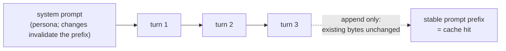
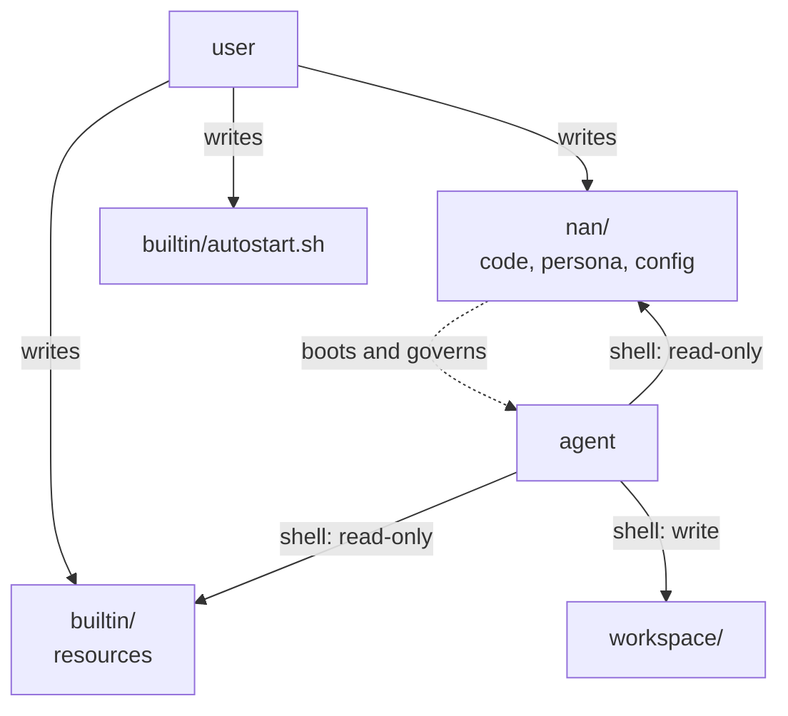

# Principles

The design rules the codebase is written against. When a change
feels ambiguous, these decide.

## Shell-first

The model already knows the shell. Tools, skills, data
processing, service management -- all of it is reachable through
`shell` as plain files. There is no tool registration, no plugin
loader, no hot-reload machinery to rebuild: the filesystem is
the ecosystem. New capabilities are added by writing files into
`builtin/` (read-only resources) or `workspace/` (agent-writable).

## One loop per agent

No thread pools of agents, no scheduler. An agent is one asyncio
task with one inbox. Concurrency comes from spawning subagents;
coordination comes from handles. This keeps death, pause and
cascade semantics exact.

## Import direction

`nan/llm/types.py` is pure data: any domain may import it.
`nan/llm/provider.py` is the transport edge, called only by
`nan/agent/engine.py`. Verb modules subclass `Verb` from
`nan/agent/verbs/__init__.py`, so the registry imports them
inside `_build_registry()` after the base class exists.

## The turn is the record

Everything that happened in a turn -- inbox drained, injections
collected, deltas observed, the reply -- lives on the Turn. No
separate trace, no side-channel logging to reconstruct behavior.
LLM calls are metered on the record (`LLMCall`: model, usage,
latency, retries).

## Add-only context

Rendered turns freeze on first render and never change. History
grows by appending; when the char limit trips, it clears whole.
Unchanged prefixes stay byte-stable, which is what makes prompt
caching work. There is no in-place rewriting of history.

## Core files vs agent territory

Three zones: the nan package (core code, persona -- the agent
cannot write these), `builtin/` (read-only resources), and
`workspace/` (the agent's writable territory, including its own
boot script `workspace/autostart.sh`). The user's boot script
lives in `builtin/` and runs outside the sandbox; the agent's
one runs inside it.

## One path for everything important

Death has one path (finish or kill, both through the same
teardown). Configuration has one source (the YAML). Event flow
has one singleton (sink). Duplicated paths drift; when two
mechanisms could do a job, the codebase picks one and deletes
the other.

## Loud failure

A missing persona fails startup. A failed turn is retried on
the backoff ladder and every failure is recorded. A sandbox
missing its tooling warns loudly. Silence hides decay; the
system is designed so that breakage is visible at the point it
happens.
