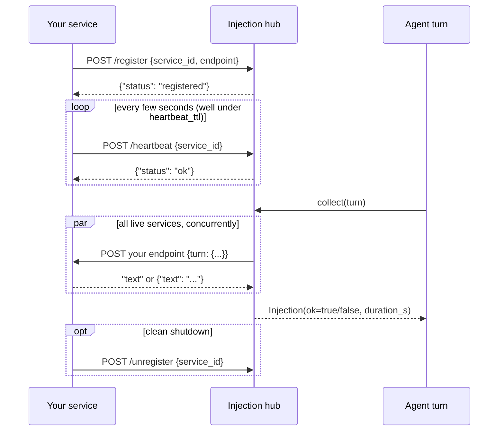
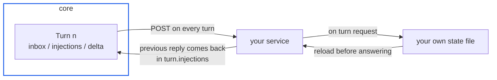
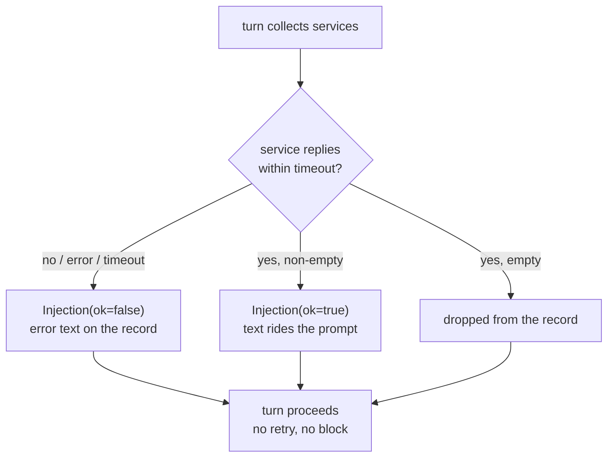

# Writing an injection service

An injection service is an independent local process that
contributes text to every prompt assembly. It is the replacement
for the old in-process module system: no registry to import, no
hot-reload contract -- just HTTP on loopback.

## Lifecycle

1. **Register** -- on startup, POST to the hub:

       POST http://127.0.0.1:8901/register
       {"service_id": "weather", "endpoint": "http://127.0.0.1:9001/turn"}

   `service_id` is your identity in the observation stream;
   `endpoint` is the URL the hub will call every turn.

2. **Heartbeat** -- POST periodically (keep the interval well
   under `injection.heartbeat_ttl`, default 15 s):

       POST /heartbeat
       {"service_id": "weather"}

   A service silent longer than the TTL is evicted; re-register
   to come back.

3. **Serve turns** -- before every prompt assembly the hub POSTs
   the turn payload to your endpoint, concurrently across all
   live services. Reply with the text you want injected, either
   plain text or JSON `{"text": "..."}`.

4. **Unregister** (optional) -- `POST /unregister` with your
   `service_id` for a clean shutdown; otherwise the TTL evicts
   you.

Introspection: `GET /services` lists live entries
(`service_id`, `endpoint`, `last_seen`).

## The turn payload

The request body is `{"turn": {...}}` -- the full new Turn as
JSON, minus the rendered messages (they are large and you do not
need them to decide what to contribute):

    {
      "agent_id":   "root",        # who is assembling a prompt
      "parent_id":  null,          # null for the root agent
      "depth":      0,
      "inbox":      [              # messages drained since last turn
        {"kind": "user", "source": "user", "text": "...",
         "event": null, "received_at": 1760000000.0}
      ],
      "injections": [              # what services contributed last
        {"service_id": "...", "text": "...", "ok": true,
         "duration_s": 0.02}       # ok=false: their error text
      ],
      "delta":      [              # state changes since last turn
        {"section": "service", "line": "+weather online"},
        {"section": "subagent", "line": "spawned a1: researching"}
      ],
      "reply":      null           # this turn's model output; null
    }                              # until the turn completes

`injections` includes your own previous reply -- use it to keep
state across turns (you are stateless to the core; persistence is
your business, typically a file under your own directory).

## Failure semantics

- The hub allows `injection.timeout` (default 2 s) per service
  per turn. There is no retry.
- A failure or timeout becomes an `Injection` with `ok: false`
  and the error text, recorded in the turn -- the agent sees it.
- An empty reply contributes nothing.
- Services are never in the critical path of the turn: a dead
  service costs one timeout, then eviction.

## Ground rules

- Loopback only; the core binds `127.0.0.1` and does not
  authenticate services (trusted-machine model).
- Return promptly. If you need longer than the timeout to compute
  a contribution, compute it eagerly (e.g. on heartbeat) and
  serve the ready text on turn requests.
- Everything you contribute is prompt text for the model: keep it
  compact, factual and stable across turns -- it rides the
  context of every turn it appears in.
