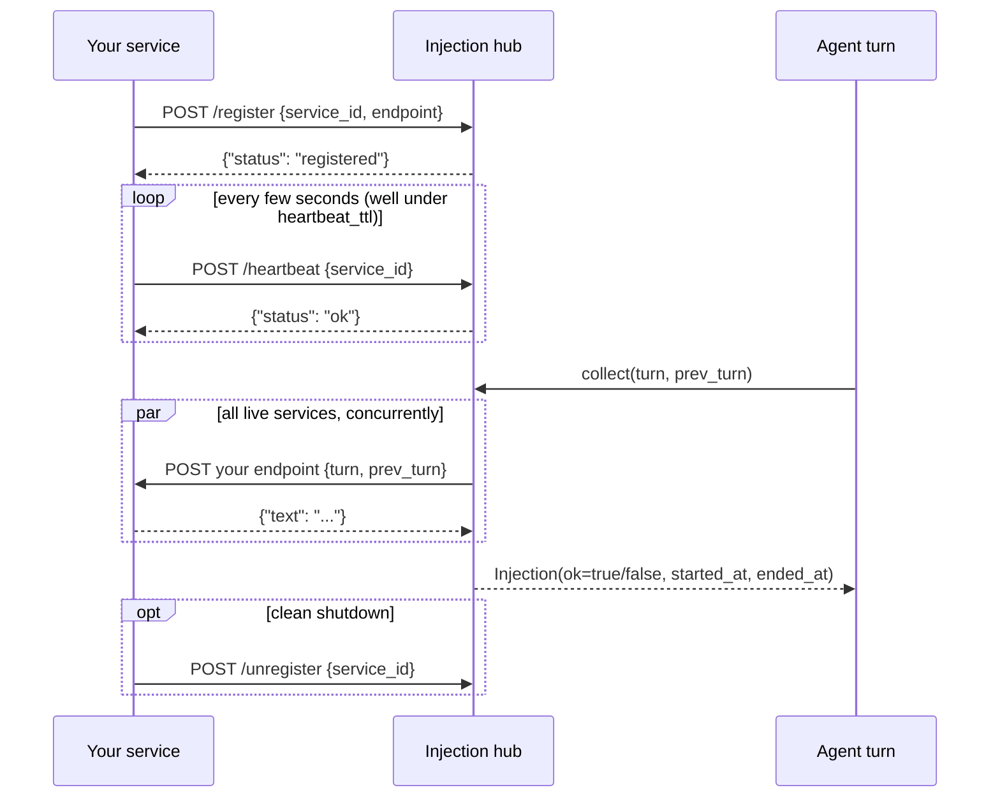
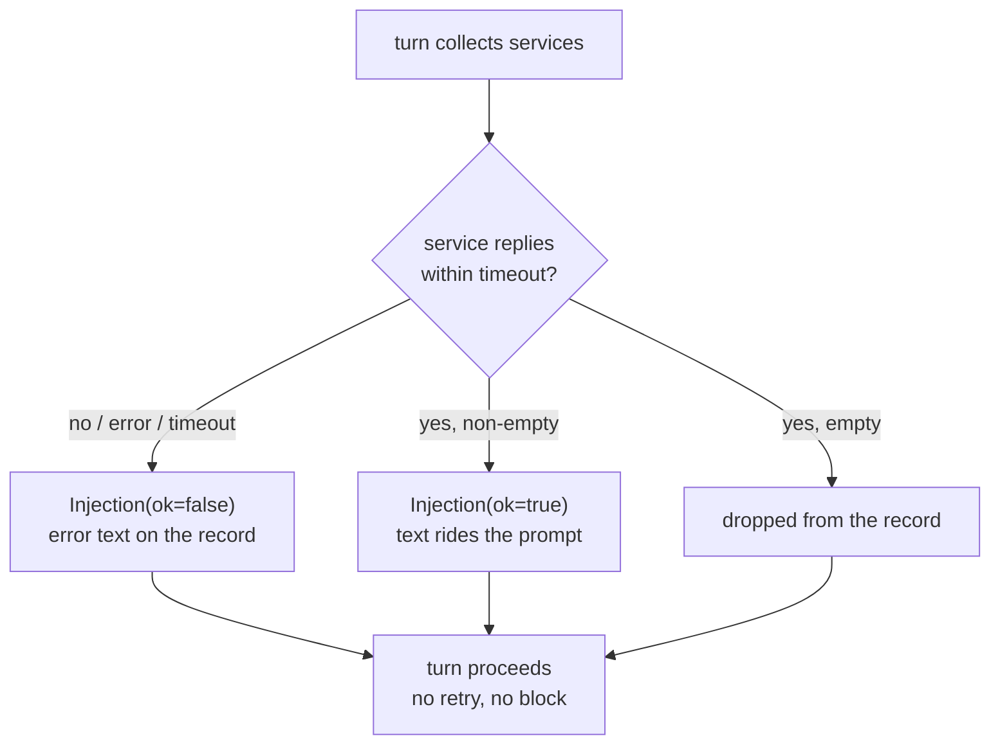

# Writing an injection service

An injection service is an independent local process that
contributes text to every prompt assembly. It is the replacement
for the old in-process module system: no registry to import, no
hot-reload contract -- just HTTP on loopback.

## Lifecycle

1. **Register** -- on startup, POST to the hub:

       POST http://127.0.0.1:8901/register
       {"service_id": "weather", "endpoint": "http://127.0.0.1:9001/turn"}

   `service_id` is your identity in the observation stream;
   `endpoint` is the URL the hub will call every turn. It must be
   loopback (`127.0.0.0/8`, `::1`, `localhost`): any other host
   is rejected at registration, so turn payloads never leave the
   machine.

2. **Heartbeat** -- POST periodically (keep the interval well
   under `injection.heartbeat_ttl`, default 15 s):

       POST /heartbeat
       {"service_id": "weather"}

   A service silent longer than the TTL simply stops receiving
   turns; the entry is not deleted, and a heartbeat brings it
   back (no re-registration needed).

3. **Serve turns** -- before every prompt assembly the hub POSTs
   the turn payload to your endpoint, concurrently across all
   live services. The reply protocol has exactly one shape: a
   JSON object `{"text": "..."}` (empty text = no contribution).
   Anything else -- plain text, a different object, a non-2xx
   status -- is recorded as a failed delivery (`ok=false`), so
   the agent still runs without your text.

4. **Unregister** (optional) -- `POST /unregister` with your
   `service_id` for a clean shutdown; otherwise the hub just
   stops routing turns to you after the TTL.

Introspection: `GET /services` returns
`{"services": [{"service_id", "endpoint", "last_seen"}]}` for
all registered entries; it is not filtered by the TTL.

## Optional: your own panel

A service may offer a UI without contributing prompt text at all.
Declare it with the gateway and re-post the same call every 10-15 s:
that POST carries the declaration and the proof of life in one
request.

    POST http://127.0.0.1:8765/surfaces
    {"service_id": "weather", "url": "http://127.0.0.1:9001/ui", "title": "weather"}

    DELETE http://127.0.0.1:8765/surfaces/weather   # optional, on shutdown

- `url` must be loopback, served by the service itself.
- `icon` is optional; when present it must be a full loopback URL
  (e.g. `http://127.0.0.1:9001/icon.svg`). A relative path resolves
  against the gateway, not your service, and 404s.
- An entry expires after `gateway.surface_ttl` (30 s) without a
  POST: the desktop removes the window. Re-posting also covers
  boot order and core restarts.
- The body is the full spec on every call: posting the same spec
  refreshes the deadline, posting a changed one replaces the
  panel. A restarted service reports its new `url` the same way.
- The panel is sandboxed without same-origin privileges, so it is
  an opaque origin and its fetches / SSE carry `Origin: null`:
  answer them with `Access-Control-Allow-Origin: null` and keep
  state on the backend.
- The panel talks to its own backend directly (see
  `docs/for-contributors/frontend-protocol.md`). The one thing the
  desktop sends it is the theme, as
  `{type: "nan:theme", theme: "light" | "dark"}` on load and on
  every switch. Panels with a dark palette listen for it; the rest
  ignore it. A panel has no theme switch of its own: light / dark is
  decided by the desktop, and by `prefers-color-scheme` only when the
  page is opened outside it.

## The turn JSON

Every turn request carries the same body, two symmetric slots:

    {"turn": {...} | null, "prev_turn": {...} | null}

- `turn` is the arriving turn in its **fresh shape**: exactly the
  fields known before the model call.
- `prev_turn` is the previous turn **complete**: the fresh fields
  plus `reply`, `calls`, `results`, `llm`, `rendered` and
  `ended_at`.
- The slots roll: each delivery's `prev_turn` completes the turn
  the previous delivery announced as `turn`. Every turn therefore
  reaches you twice, once arriving and once completed. The first
  turn of an agent arrives with `prev_turn: null`.
- Both keys are always present, null when empty, so every body
  parses the same way and a service that keeps `prev_turn`
  reconstructs the whole agent life from it alone.
- Death is the one delivery with no arriving turn: the core makes
  the same call with `turn: null` and the last turn complete as
  `prev_turn`, whose `state` is `end`.

### Arriving turn (fresh shape)

    {
      "agent_id":   "root",        # who is assembling a prompt
      "parent_id":  null,          # null for the root agent
      "depth":      0,
      "state":      "start",       # start | running |
                                   # context_cleared
      "persona":    null,          # new persona text when it changed
                                   # before this turn, else null
      "inbox":      [              # messages drained since last turn
        {"kind": "user", "source": "user", "text": "...",
         "event": "send", "received_at": 1760000000.0}
      ],
      "injections": [],            # empty on arrival; see below
      "delta":      [              # state changes since last turn
        {"section": "service", "line": "+weather online"},
        {"section": "subagent", "line": "spawned a1: researching"}
      ],
      "started_at": 1760000000.0
    }

### Completing turn (full shape)

    {
      "agent_id": "root", "parent_id": null, "depth": 0,
      "state": "running", "persona": null,
      "inbox": [...], "delta": [...],
      "injections": [              # this turn's own contributions,
        {"service_id": "weather",  # recorded after delivery
         "text": "...", "ok": true,
         "started_at": 1760000000.5, "ended_at": 1760000000.6}
      ],
      "reply":   "checking the forecast now",
      "calls":   [{"id": "t1", "name": "shell",
                   "arguments": {"command": "..."}}],
      "results": [{"call_id": "t1", "name": "shell",
                   "output": "exit code: 0\n...",
                   "started_at": 1760000000.6, "ended_at": 1760000000.8}],
      "llm":     {"model": "...", "started_at": 1760000000.1,
                  "ended_at": 1760000000.9,
                  "usage": {"prompt_tokens": 0, "completion_tokens": 0},
                  "finish_reason": "stop", "retries": 0},
      "rendered": [{"role": "system", "content": "..."}],
      "started_at": 1760000000.0, "ended_at": 1760000000.9
    }

`calls` is positional with `results`; `rendered` is the frozen
message run this turn contributed to the prompt, in the same
`Message` shape the provider receives.

### Fields shared by both shapes

`state` marks the agent's lifecycle at delivery time: `start`
(first turn of an agent), `running`, `context_cleared` (the
first turn after the rendered history was cleared wholesale --
rendered sequences do not cross this boundary), and `end` (the
final delivery, which appears as `prev_turn.state`).

`persona` is the epoch marker for the system prompt: the new
persona text on the one turn where the file content changed
before assembly, null on every other turn. A service that keys
state per persona epoch can see exactly where it started.

The `injections` array is empty on arrival: this turn's own
contributions are collected after delivery. Each entry (seen in
`prev_turn`) is `{service_id, text, ok, started_at, ended_at}`
(`ok=false`: the error text). Your own previous reply therefore
comes back in `prev_turn.injections`, not in the arriving
`turn.injections` -- use it to keep state across turns (you are
stateless to the core; persistence is your business, typically a
file under your own directory).

## Failure semantics

- The hub allows `injection.timeout` (default 2 s) per service
  per turn. There is no retry.
- A failure or timeout becomes an `Injection` with `ok: false`
  and the error text, recorded in the turn -- the agent sees it.
- An empty reply contributes nothing.
- Services are never in the critical path of the turn: a dead
  service costs one timeout, then leaves the live set.

## Ground rules

- Loopback only; the core binds `127.0.0.1` and does not
  authenticate services (trusted-machine model).
- Return promptly. If you need longer than the timeout to compute
  a contribution, compute it eagerly (e.g. on heartbeat) and
  serve the ready text on turn requests.
- Everything you contribute is prompt text for the model: keep it
  compact, factual and stable across turns -- it rides the
  context of every turn it appears in.
