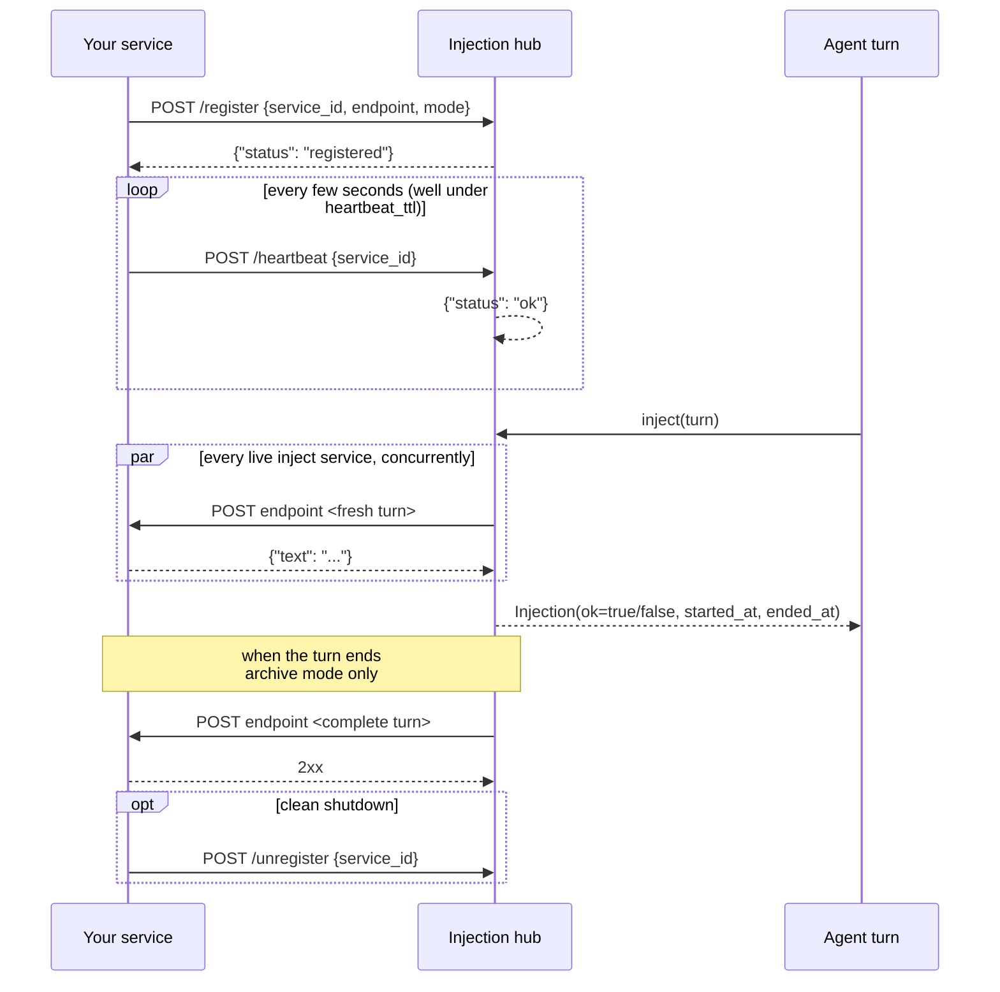
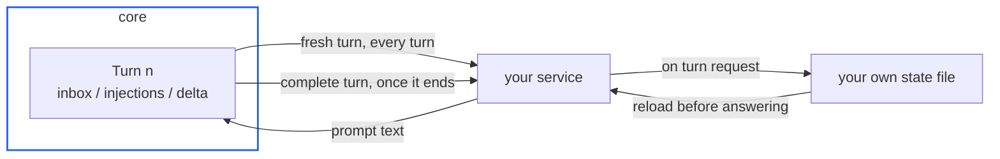
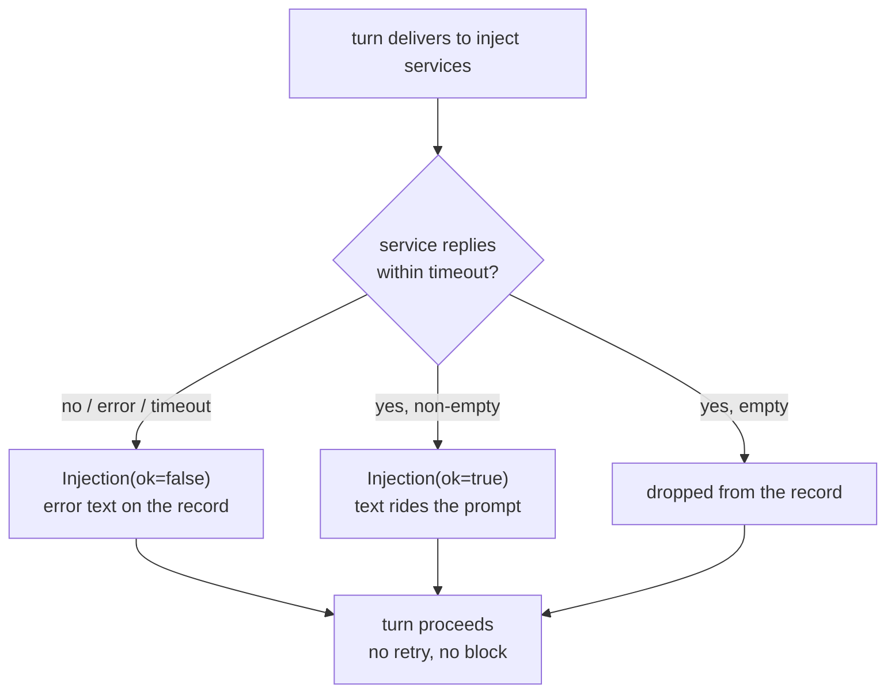

# Writing an injection service

An injection service is an independent local process that
contributes text to every prompt assembly. It is the replacement
for the old in-process module system: no registry to import, no
hot-reload contract -- just HTTP on loopback.

## Lifecycle

1. **Register** -- on startup, POST to the hub:

       POST http://127.0.0.1:8901/register
       {"service_id": "weather", "endpoint": "http://127.0.0.1:9001/turn",
        "mode": "inject"}

   `service_id` is your identity in the observation stream;
   `endpoint` is the URL the hub will call. It must be loopback
   (`127.0.0.0/8`, `::1`, `localhost`): any other host is rejected
   at registration, so turn payloads never leave the machine.

   `mode` decides which delivery you receive and defaults to
   `inject`:

   - `inject` -- the fresh turn before every prompt assembly; your
     reply is prompt text, recorded as an `Injection`.
   - `archive` -- the complete turn once it ends; your reply is only
     an acknowledgement and is never recorded. This is the mode for
     services whose work is recording, such as `record`.
     A process may hold both modes as two `service_id`s.

2. **Heartbeat** -- POST periodically (keep the interval well
   under `injection.heartbeat_ttl`, default 15 s):

       POST /heartbeat
       {"service_id": "weather"}

   A service silent longer than the TTL simply stops receiving
   turns; the entry is not deleted, and a heartbeat brings it
   back (no re-registration needed).

3. **Serve turns** -- an `inject` service receives the fresh turn
   before every prompt assembly, concurrently across all live
   services. Its reply has exactly one shape: a JSON object
   `{"text": "..."}` (empty text = no contribution). Anything else
   -- plain text, a different object, a non-2xx status -- is
   recorded as a failed delivery (`ok=false`), so the agent still
   runs without your text.

   An `archive` service receives the complete turn once it ends;
   any 2xx is enough, and the body is ignored.

4. **Unregister** (optional) -- `POST /unregister` with your
   `service_id` for a clean shutdown; otherwise the hub just
   stops routing turns to you after the TTL.

Introspection: `GET /services` returns
`{"services": [{"service_id", "endpoint", "mode", "last_seen"}]}` for
all registered entries; it is not filtered by the TTL.

## Optional: your own panel

A service may offer a UI without contributing prompt text at all.
Declare it with the gateway and re-post the same call every 10-15 s:
that POST carries the declaration and the proof of life in one
request.

    POST http://127.0.0.1:8765/surfaces
    {"service_id": "weather", "url": "http://127.0.0.1:9001/ui", "title": "weather"}

    DELETE http://127.0.0.1:8765/surfaces/weather   # optional, on shutdown

- `url` must be loopback, served by the service itself.
- `icon` is optional; when present it must be a full loopback URL
  (e.g. `http://127.0.0.1:9001/icon.svg`). A relative path resolves
  against the gateway, not your service, and 404s.
- An entry expires after `gateway.surface_ttl` (30 s) without a
  POST: the desktop removes the window. Re-posting also covers
  boot order and core restarts.
- The body is the full spec on every call: posting the same spec
  refreshes the deadline, posting a changed one replaces the
  panel. A restarted service reports its new `url` the same way.
- The panel is sandboxed without same-origin privileges, so it is
  an opaque origin and its fetches / SSE carry `Origin: null`:
  answer them with `Access-Control-Allow-Origin: null` and keep
  state on the backend.
- The panel talks to its own backend directly (see
  `docs/for-contributors/frontend-protocol.md`). The one thing the
  desktop sends it is the theme, as
  `{type: "nan:theme", theme: "light" | "dark"}` on load and on
  every switch. Panels with a dark palette listen for it; the rest
  ignore it. A panel has no theme switch of its own: light / dark is
  decided by the desktop, and by `prefers-color-scheme` only when the
  page is opened outside it.

## The turn JSON

One delivery body is one turn, flat -- never a slot that can be
empty:

    { ...turn fields... }

- `inject` services receive it in its **fresh shape**: exactly the
  fields known before the model call.
- `archive` services receive it **complete**, when the turn ends:
  the fresh fields plus `injections`, `reply`, `calls`, `results`,
  `llm`, `death`, `rendered` and `ended_at`.
- An agent that stops simply stops: there is no exit delivery.
  The last completed turn is the last thing an archive sees, and a
  turn cut short by death never reaches it at all.
- Both modes appear in the `delta` section, so the model still
  learns that an archive service is online.

### Fresh turn

    {
      "agent_id":   "root",        # who is assembling a prompt
      "parent_id":  null,          # null for the root agent
      "depth":      0,
      "origin":     "first",       # first | normal |
                                   # context_cleared
      "persona":    null,          # new persona text when it changed
                                   # before this turn, else null
      "inbox":      [              # messages drained since last turn
        {"kind": "user", "source": "user", "text": "...",
         "event": "send", "received_at": 1760000000.0}
      ],
      "injections": [],            # empty on arrival; see below
      "delta":      [              # state changes since last turn
        {"section": "service", "line": "+weather online"},
        {"section": "subagent", "line": "spawned a1: researching"}
      ],
      "started_at": 1760000000.0
    }

### Completing turn (full shape)

    {
      "agent_id": "root", "parent_id": null, "depth": 0,
      "origin": "normal", "persona": null,
      "inbox": [...], "delta": [...],
      "injections": [              # this turn's own contributions,
        {"service_id": "weather",  # recorded after delivery
         "text": "...", "ok": true,
         "started_at": 1760000000.5, "ended_at": 1760000000.6}
      ],
      "reply":   "checking the forecast now",
      "calls":   [{"id": "t1", "name": "shell",
                   "arguments": {"command": "..."}}],
      "results": [{"call_id": "t1", "name": "shell",
                   "output": "exit code: 0\n...",
                   "started_at": 1760000000.6, "ended_at": 1760000000.8}],
      "llm":     {"model": "...", "started_at": 1760000000.1,
                  "ended_at": 1760000000.9,
                  "usage": {"prompt_tokens": 0, "completion_tokens": 0},
                  "finish_reason": "stop", "retries": 0},
      "rendered": [{"role": "system", "content": "..."}],
      "death":    null,           # {"reason", "report"} when this
                                  # turn ended the agent, else null
      "started_at": 1760000000.0, "ended_at": 1760000000.9
    }

`calls` is positional with `results`; `rendered` is the frozen
message run this turn contributed to the prompt, in the same
`Message` shape the provider receives.

### Fields

`origin` says why the turn began: `first` (the agent's first turn),
`normal`, or `context_cleared` (the first turn after the rendered
history was cleared wholesale -- rendered sequences do not cross
this boundary). It says nothing about whether the turn ended;
`ended_at` and the delivery channel do.

`death` appears only on a completed turn and only when that turn
ended the agent: `reason` is the exit reason, `report` the finish
report when the model ended it itself (null for external deaths).
A turn cut short before it completes is never delivered, so an
archive can see an agent stop only through the turn that ended it.

`persona` is the epoch marker for the system prompt: the new
persona text on the one turn where the file content changed
before assembly, null on every other turn. A service that keys
state per persona epoch can see exactly where it started.

The `injections` array is empty in the fresh shape: this turn's own
contributions are collected after delivery. The completed turn
carries them, `{service_id, text, ok, started_at, ended_at}`
(`ok=false`: the error text). So your reply comes back to you in
the archive copy of the same turn, not on a later turn -- if you
need your own past answers while assembling, keep them yourself
(you are stateless to the core; persistence is your business,
typically a file under your own directory).

## Failure semantics

- The hub allows `injection.timeout` (default 2 s) per service
  per turn. There is no retry.
- A failure or timeout becomes an `Injection` with `ok: false`
  and the error text, recorded in the turn -- the agent sees it.
- An empty reply contributes nothing.
- Services are never in the critical path of the turn: a dead
  service costs one timeout, then leaves the live set.

## Ground rules

- Loopback only; the core binds `127.0.0.1` and does not
  authenticate services (trusted-machine model).
- Return promptly. If you need longer than the timeout to compute
  a contribution, compute it eagerly (e.g. on heartbeat) and
  serve the ready text on turn requests.
- Everything you contribute is prompt text for the model: keep it
  compact, factual and stable across turns -- it rides the
  context of every turn it appears in.

## The service kit

`lib/nan-service-kit` (`nan_service_kit`) holds the shell every
service shares: reading config, registering and heartbeating,
logging, and the doubles its tests use. A service depends on it as
a path dependency:

    nan-service-kit = { path = "../../../lib/nan-service-kit", editable = true }

What it owns, so you do not write it again:

- **Config** -- subclass `ServiceConfig` with your own keys, then
  `read_config(YourConfig, Path(__file__).parent / "config.yaml")`.
  Defaults are filled by the kit: `service_id` from the directory
  name, `hub_url` from `NAN_INJECTION_PORT` (falling back to 8901),
  `gateway_url` 8765, `mode` `inject`. The file wins wherever it
  says something. `config.home` and `config.logs_dir` are bound to
  the directory the config was read from: logs go under `logs/`, and
  state is whatever you name under `home`.
- **Lifecycle** -- `async with HubLink(config):` registers, heartbeats
  every 5 s, re-registers when the hub answers `{"status": "unknown"}`
  (it forgot you after a restart), re-posts your panel when
  `config.surface` is set, and unregisters on exit. Every post is
  best effort: an absent hub costs a warning line, never a failed
  request.
- **Logging** -- `setup_logging(config)` sends loguru to
  `logs/<service_id>.log` (10 MB, 3 kept). The boot scripts capture
  only what is printed before that, in `logs/<name>.boot.log`, so
  neither file has two writers.
- **Tests** -- `StubHub` stands in for the hub and gateway with a
  recorder; `assert_registered`, `assert_turn_text`,
  `assert_turn_ack` state the contract once:

      assert_registered(stub, config)      # what you register, in one shape
      assert_turn_text(client, "hello")   # {"text": <str>} and nothing else

  `system`, `network`, `mcp` and `record` each keep a
  `tests/test_contract.py` built exactly this way; copy it.

