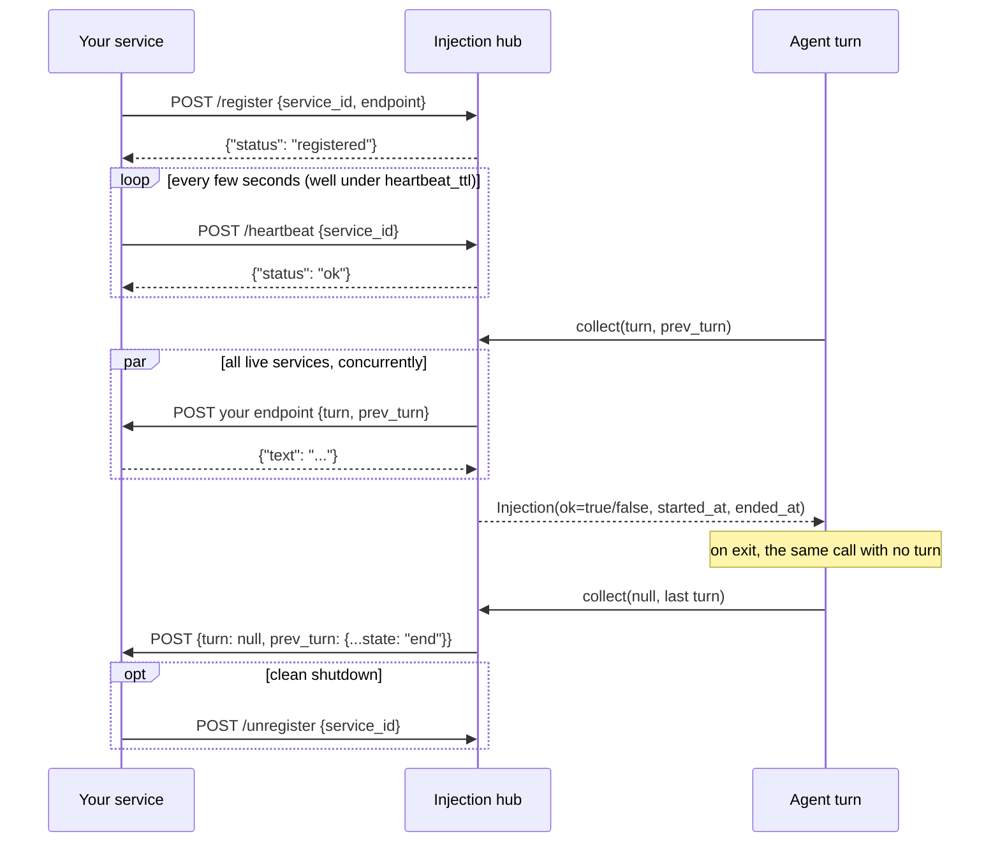
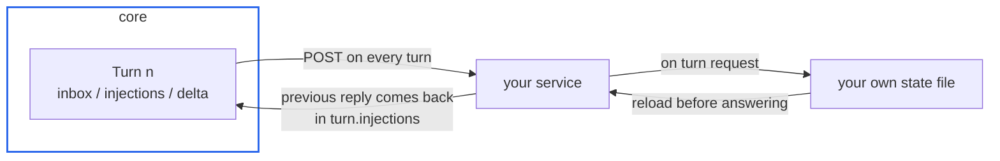
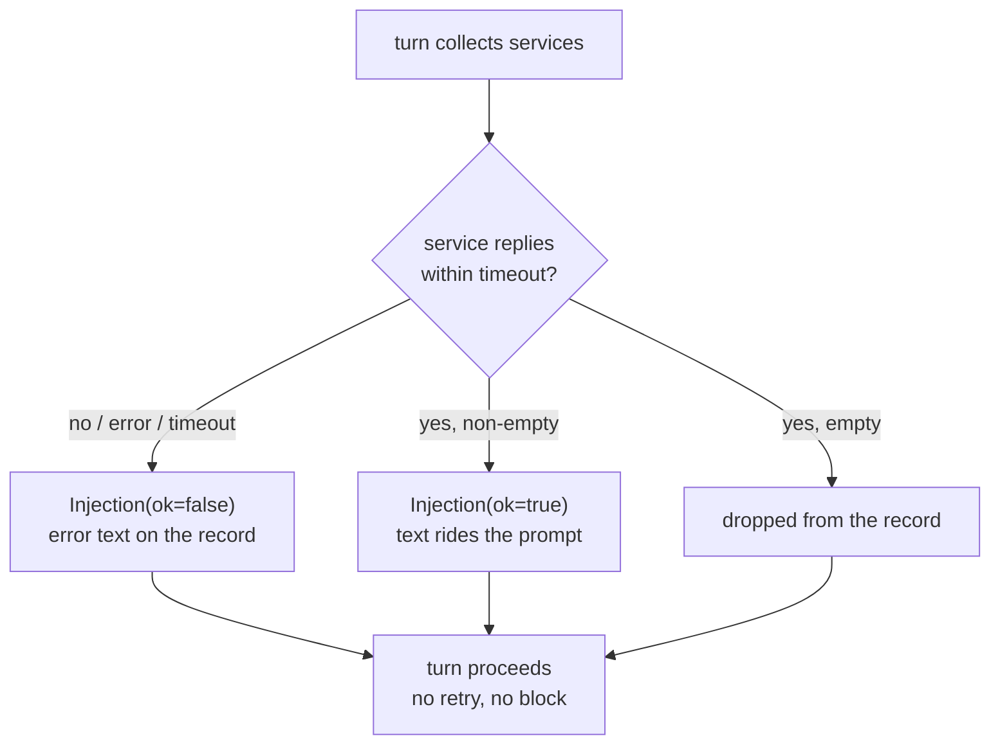

# Writing an injection service

An injection service is an independent local process that
contributes text to every prompt assembly. It is the replacement
for the old in-process module system: no registry to import, no
hot-reload contract -- just HTTP on loopback.

## Lifecycle

1. **Register** -- on startup, POST to the hub:

       POST http://127.0.0.1:8901/register
       {"service_id": "weather", "endpoint": "http://127.0.0.1:9001/turn"}

   `service_id` is your identity in the observation stream;
   `endpoint` is the URL the hub will call every turn. It must be
   loopback (`127.0.0.0/8`, `::1`, `localhost`): any other host
   is rejected at registration, so turn payloads never leave the
   machine.

2. **Heartbeat** -- POST periodically (keep the interval well
   under `injection.heartbeat_ttl`, default 15 s):

       POST /heartbeat
       {"service_id": "weather"}

   A service silent longer than the TTL is evicted; re-register
   to come back.

3. **Serve turns** -- before every prompt assembly the hub POSTs
   the turn payload to your endpoint, concurrently across all
   live services. The reply protocol has exactly one shape: a
   JSON object `{"text": "..."}` (empty text = no contribution).
   Anything else -- plain text, a different object, a non-2xx
   status -- is recorded as a failed delivery (`ok=false`), so
   the agent still runs without your text.

4. **Unregister** (optional) -- `POST /unregister` with your
   `service_id` for a clean shutdown; otherwise the TTL evicts
   you.

Introspection: `GET /services` lists live entries
(`service_id`, `endpoint`, `last_seen`).

## Optional: your own panel

A service may offer a UI without contributing prompt text at all.
Register it with the gateway and the desktop puts it in the rail:

    POST http://127.0.0.1:8765/surfaces
    {"service_id": "weather", "url": "http://127.0.0.1:9001/ui", "title": "weather"}

    DELETE http://127.0.0.1:8765/surfaces/weather   # on shutdown

- `url` must be loopback, served by the service itself.
- The panel is sandboxed without same-origin privileges, so it is
  an opaque origin: answer its requests with
  `Access-Control-Allow-Origin: *` and keep state on the backend.
- There is no desktop bridge; the panel talks to its own backend
  directly (see `docs/for-contributors/frontend-protocol.md`).

## The turn payload

The request body is `{"turn": {...} | null, "prev_turn": {...} | null}`
-- a self-contained delivery in two symmetric slots:

- `turn` is the arriving turn in its **fresh shape**: the static
  fields known before the model call. `reply`, `calls`,
  `results`, `llm`, `ended_at` and `rendered` are
  structurally absent, never null placeholders.
- `prev_turn` is the previous turn **complete**: reply, tool
  calls, metering and the frozen rendered message run included.
- The slots roll: each delivery's `prev_turn` completes the turn
  the previous delivery announced as `turn`. The first turn of an
  agent arrives with `prev_turn: null`. On exit the core makes
  **the same call** with no arriving turn: `turn: null`, the last
  turn complete as `prev_turn`, marked `state: "end"`. Both keys
  are always present, null when empty, so every body parses the
  same way and a service that keeps `prev_turn` reconstructs the
  whole agent life from it alone.

    {
      "agent_id":   "root",        # who is assembling a prompt
      "parent_id":  null,          # null for the root agent
      "depth":      0,
      "state":      "start",       # start | running |
                                   # context_cleared | end
      "persona":    null,          # new persona text when it changed
                                   # before this turn, else null
      "inbox":      [              # messages drained since last turn
        {"kind": "user", "source": "user", "text": "...",
         "event": "send", "received_at": 1760000000.0}
      ],
      "injections": [              # what services contributed last
        {"service_id": "...", "text": "...", "ok": true,
         "started_at": 1760000000.0,
         "ended_at": 1760000000.02}  # ok=false: their error text
      ],
      "delta":      [              # state changes since last turn
        {"section": "service", "line": "+weather online"},
        {"section": "subagent", "line": "spawned a1: researching"}
      ],
      "started_at": 1760000000.0
    }

`state` marks the agent's lifecycle at delivery time: `start`
(first turn of an agent), `running`, `context_cleared` (the
first turn after the rendered history was cleared wholesale --
rendered sequences do not cross this boundary), and `end` (the
exit payload, where the slot is `prev_turn`).

`persona` is the epoch marker for the system prompt: the new
persona text on the one turn where the file content changed
before assembly, null on every other turn. A service that keys
state per persona epoch can see exactly where it started.

`injections` includes your own previous reply -- use it to keep
state across turns (you are stateless to the core; persistence is
your business, typically a file under your own directory).

## Failure semantics

- The hub allows `injection.timeout` (default 2 s) per service
  per turn. There is no retry.
- A failure or timeout becomes an `Injection` with `ok: false`
  and the error text, recorded in the turn -- the agent sees it.
- An empty reply contributes nothing.
- Services are never in the critical path of the turn: a dead
  service costs one timeout, then eviction.

## Ground rules

- Loopback only; the core binds `127.0.0.1` and does not
  authenticate services (trusted-machine model).
- Return promptly. If you need longer than the timeout to compute
  a contribution, compute it eagerly (e.g. on heartbeat) and
  serve the ready text on turn requests.
- Everything you contribute is prompt text for the model: keep it
  compact, factual and stable across turns -- it rides the
  context of every turn it appears in.
