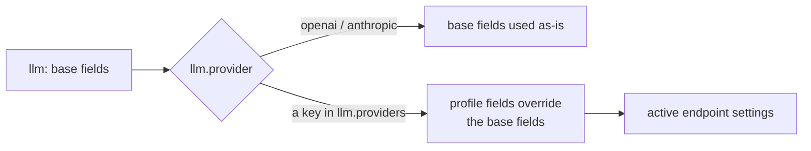

# Configuration

The single source is `config/nan.yaml`. Nothing else is read: no
environment variables, no dotenv files. Relative paths in the
YAML resolve against the config file's grandparent (the repo
root). An alternative file can be passed as the first CLI
argument (`uv run nan path/to/nan.yaml`); its grandparent then
anchors the paths.

## llm

| Key | Default | Meaning |
|-----|---------|---------|
| `provider` | `"openai"` | The active entry: `"openai"`, `"anthropic"`, or the key of a profile below |
| `base_url` | `""` | Endpoint URL; empty = provider default |
| `api_key` | `""` | Empty = SDK default behavior (env fallback inside the SDK) |
| `model` | `""` | Model name sent to the endpoint |
| `timeout` | `120.0` | Per-request timeout (seconds) |
| `max_retries` | `2` | SDK-level retry count |
| `providers` | `{}` | Named endpoint profiles (see below) |

A profile overrides the base fields it sets; the profile's own
`provider` field carries the protocol type.

Example -- a local
27B model behind llama.cpp:

    llm:
      provider: local27b
      providers:
        local27b:
          provider: openai          # OpenAI-compatible protocol
          base_url: http://127.0.0.1:8080/v1
          model: qwen-27b
          api_key: none

## agent

| Key | Default | Meaning |
|-----|---------|---------|
| `autonomous_interval` | `0.0` | `>0`: the root agent self-rotates with this pacing (seconds); `<=0`: event-driven (turns happen when input arrives) |
| `history_char_limit` | `100000` | Rendered-history size cap; exceeding it clears the whole history (a reset, not a rewrite) |
| `shell_timeout` | `30.0` | `shell` verb execution timeout; the model cannot change it |
| `shell_output_limit` | `20000` | `shell` verb output truncation size (head + tail kept, middle elided) |
| `backoff` | `[1.0, 2.0, 4.0, 8.0, 15.0, 30.0, 60.0]` | Turn-failure retry ladder (seconds); a failed turn is retried whole after these delays |
| `max_depth` | `3` | Spawn depth limit; `-1` = unlimited |
| `max_children` | `5` | Per-agent children limit; `-1` = unlimited |
| `persona_path` | `nan/persona.md` | The persona file, re-read every turn; must exist at boot |

## sandbox

| Key | Default | Meaning |
|-----|---------|---------|
| `enabled` | `true` | Wrap `shell` commands in the OS-level sandbox |
| `required` | `false` | `true`: refuse to execute when no sandbox tool exists (instead of running degraded) |

## injection

The registry the external prompt-contributor services talk to.

| Key | Default | Meaning |
|-----|---------|---------|
| `host` | `127.0.0.1` | Registry listen address |
| `port` | `8901` | Registry port |
| `timeout` | `2.0` | Per-service, per-turn collection timeout |
| `heartbeat_ttl` | `15.0` | A service silent longer than this is evicted from the live set |

## gateway

| Key | Default | Meaning |
|-----|---------|---------|
| `host` | `127.0.0.1` | Listen address |
| `port` | `8765` | HTTP + WebSocket port |
| `frontend_dir` | `null` | Default: `<repo>/frontend/dist` when it exists |

## autostart

| Key | Default | Meaning |
|-----|---------|---------|
| `enabled` | `true` | Run the autostart script once at boot |
| `path` | `null` | Default: `workspace/autostart.sh` (user-owned; the one workspace file the agent must not edit) |

## Top-level paths

| Key | Default | Meaning |
|-----|---------|---------|
| `workspace` | `workspace` | The agents' writable territory |
| `builtin_dir` | `builtin` | Read-only resource root (tools/skills as plain files) |
