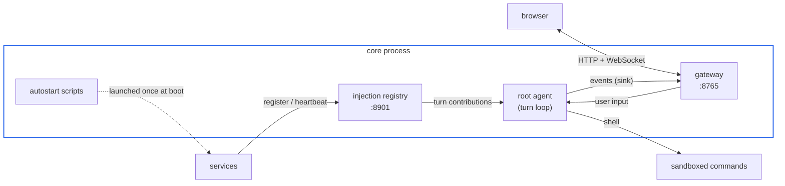

# Get started

## Prerequisites

- Python 3.12+ and [uv](https://docs.astral.sh/uv/)
- An LLM endpoint: any OpenAI-compatible API or the Anthropic API
  (a local llama.cpp/vLLM server works -- see `llm.base_url` in
  the configuration reference)

## Install

    uv sync

## Configure

All configuration lives in one file: `config/nan.yaml`. The
minimum you must fill in is the active model:

    llm:
      provider: openai          # "openai" | "anthropic"
      base_url: ""              # empty = provider default endpoint
      api_key: ""
      model: ""

The persona file (`nan/persona.md` by default) must exist -- the
core refuses to start without it. Edit it to define who the agent
is; it is re-read every turn and it is a core file: the agent
cannot rewrite it.

## Run

    uv run nan                  # or: uv run python -m nan.app

What starts:

- the agent loop (root agent; event-driven by default, or
  self-rotating with `agent.autonomous_interval > 0`)
- the gateway web UI on `http://127.0.0.1:8765` (serving
  `frontend/dist`, located automatically; the browser opens once
  the socket is up)
- the injection registry on `127.0.0.1:8901`
- the autostart scripts, if enabled and present: `builtin/autostart.sh`
  (user-owned, unsandboxed) and `workspace/autostart.sh` (agent-writable,
  sandboxed)

Open the gateway URL and talk to the agent. Input goes to the
root agent's inbox; its replies and subagent output stream into
the UI.

## First tools

The agent's only verb for reaching the world is `shell`. Tools
and skills are plain files under `builtin/` (read-only) and
`workspace/` (agent-writable); the agent invokes them with
ordinary shell commands inside the execution sandbox. Drop a
script into `workspace/` and it is immediately usable -- there is
nothing to register, reload or configure.
