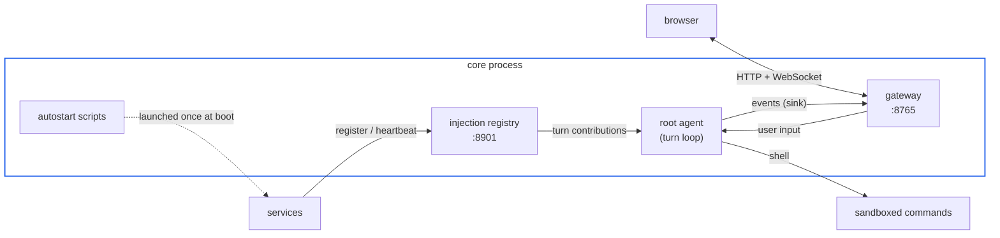

# Get started

## Prerequisites

- Python 3.12+ and [uv](https://docs.astral.sh/uv/)
- An LLM endpoint: any OpenAI-compatible API or the Anthropic API
  (a local llama.cpp/vLLM server works -- see `llm.base_url` in
  the configuration reference)
- macOS or Linux. On Windows, run NAN inside
  [WSL2](https://learn.microsoft.com/en-us/windows/wsl/install),
  where bubblewrap and the Unix shell the runtime builds on are
  available. See the note in the README.
- Node.js 18+ for the web UI (optional: the core starts and serves
  `/ws` and `/surfaces` without it).

## Install

One-liner for macOS or Linux: installs uv if missing, clones to
`~/nan` (override with `NAN_HOME`), syncs dependencies, and builds
the web UI:

    curl -fsSL https://raw.githubusercontent.com/DarkSpaceY/NAN-itself/main/scripts/install.sh | sh

Or install manually. Sync the python dependencies:

    uv sync

Build the web UI:

    cd frontend && npm install && npm run build

## Configure

All configuration lives in one file: `config/nan.yaml`. It is
git-ignored (it holds your key), so start from the template:

    cp config/nan.yaml.example config/nan.yaml

The minimum you must fill in is the active model:

    llm:
      provider: openai          # "openai" | "anthropic"
      base_url: ""              # empty = provider default endpoint
      api_key: ""
      model: ""

The persona file (`nan/persona.md` by default) is required at
startup. Edit it to define who the agent is; it is re-read every
turn, and the sandbox keeps the package read-only for the agent.

## Run

    uv run nan                  # or: uv run python -m nan.app

What starts:

- the agent loop (the root agent starts it; each agent runs
  event-driven by default, or self-rotating with
  `agent.autonomous_interval > 0`)
- the gateway web UI on `http://127.0.0.1:8765` (serving
  `frontend/dist`; without `frontend/dist/index.html` the gateway
  still serves `/ws` and `/surfaces`, and the browser opens once the
  port accepts connections)
- the injection registry on `127.0.0.1:8901`
- the autostart scripts, if enabled and present: `builtin/autostart.sh`
  (user-owned, unsandboxed) and `workspace/autostart.sh` (agent-writable,
  sandboxed); the core stops what they start when it exits

Open the gateway URL and talk to the agent. Input goes to the
root agent's inbox; its replies and subagent output stream into
the UI.

## First tools

The agent reaches the outside world through `shell`. Tools and
skills are plain files under `builtin/` (read-only) and
`workspace/` (agent-writable); the agent invokes them with ordinary
shell commands inside the execution sandbox. A script dropped into
`workspace/` is available to the next shell call.
