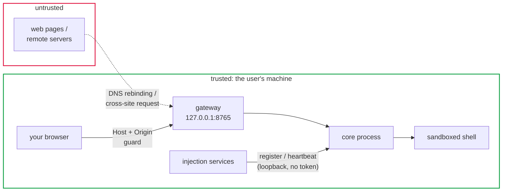
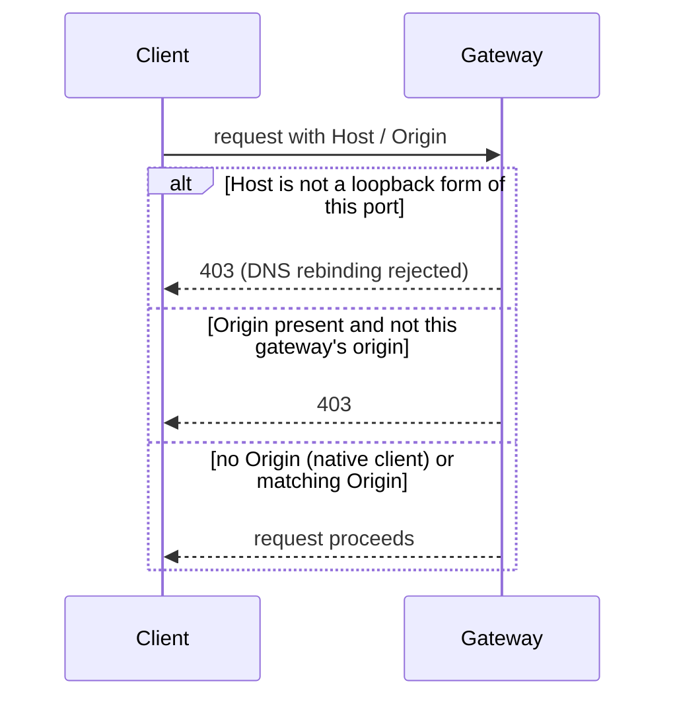
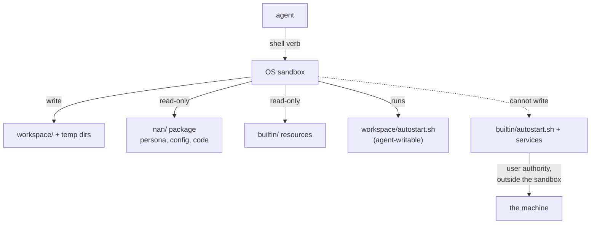

# Security model

## Trusted machine

Like the CLI-agent baseline (Claude Code, Codex), NAN-itself trusts the
user's own machine. The security model defends against remote
parties, not against malicious local processes.

## Network listeners

Both listeners bind loopback only.

**Gateway** (browser-facing). An entry guard runs at the HTTP
and WebSocket handshakes:

- `Host` must be a loopback form of the gateway's own port
  (`127.0.0.1:<port>`, `localhost:<port>`, `[::1]:<port>`).
  A DNS-rebinding request carries the attacker's domain in
  `Host` and is rejected.
- `Origin`, when present, must be the gateway's own loopback
  origin. Native clients (curl, ws tools) send no `Origin` and
  pass; browsers always send one and cannot forge it, which is
  what makes this an authentication boundary.

**Injection registry** (service-facing). The same guard applies
to `127.0.0.1:8901`, so a hostile page cannot POST a fake
service into the chain from the browser. No token: local
process trust is the boundary, consistent with the
trusted-machine model.

**Outbound destinations.** Every URL the core will call or hand
to the desktop must resolve textually to loopback
(`127.0.0.0/8`, `::1`, `localhost`):

- a service `endpoint` outside loopback is rejected at
  registration -- no turn payload can leave the machine;
- a panel `url` outside loopback is rejected -- the desktop
  never loads an internet page;
- a panel `icon` must be a local path or a loopback URL, so the
  rail cannot leak a request to the internet.

These are checked on the literal URL; no DNS resolution
happens, so a loopback name can never be rebound to a public
address.

## Execution sandbox

Shell verbs run under an OS-level sandbox (macOS `sandbox-exec`
with an SBPL profile, Linux bubblewrap):

- writes confined to the workspace and temp directories
- the nan package (persona, config) and builtin resources are
  read-only
- modes: enforcing (sandbox active) / degraded (sandbox tooling
  missing -- loud warning, execution continues) / required
  (`sandbox.required: true` -- missing tooling refuses to
  execute)

Services and `builtin/autostart.sh` run with user authority,
outside the sandbox. `workspace/autostart.sh` is the opposite:
agents may write it (to set up their own boot services), and it
runs inside the same sandbox as their shell commands, so its
writes stay confined too.

## Agent authority limits

- `shell_timeout` and `shell_output_limit` come from user
  configuration; the model cannot change them.
- The persona file is core config the agent cannot rewrite.
- Tools and skills are plain files reached through the sandboxed
  shell; there is no registration path that bypasses it.

## LLM endpoint

The configured LLM endpoint receives the assembled conversation:
task text, persona, injection contributions, tool/skill output
the agent observed. Choose endpoints accordingly (see
`llm.base_url` for pointing NAN-itself at a local model).

## Known residual risks

- A model-generated service/tool file may reference paths outside
  the workspace; the sandbox confines execution, but file writes
  through non-shell channels are not separately fenced.
- Smaller models may emit malformed tool-call JSON, which
  currently fails the turn loudly (backoff + retry) rather than
  being repaired.
