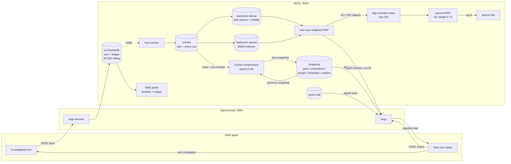
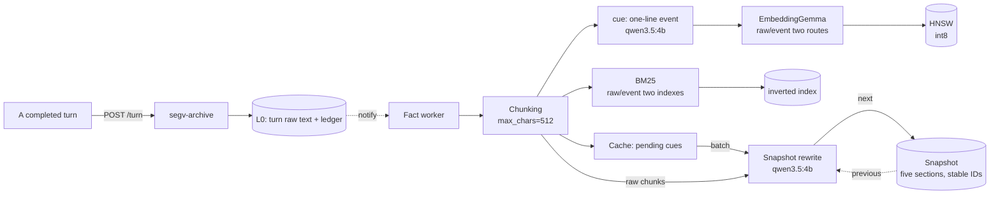
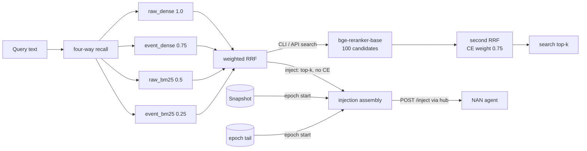
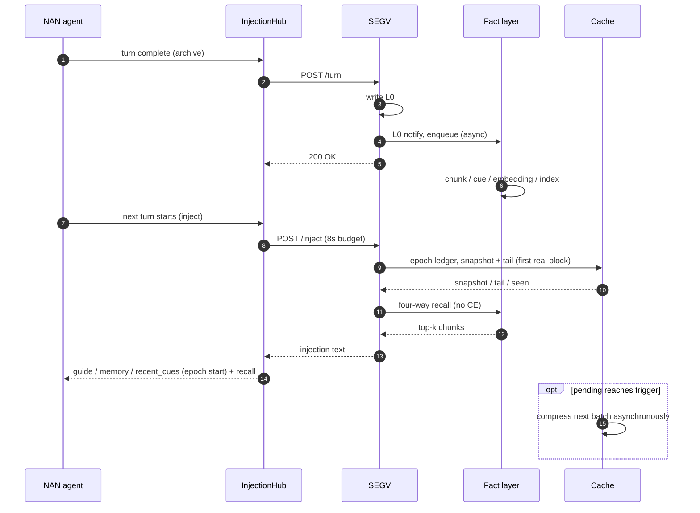

# SEGV Long-Term Memory Service

> This document only covers the `workspace/services/segv` service, not the overall architecture or usage of NAN core.

SEGV is a standalone memory service that listens only on loopback. It observes every completed turn of the NAN agent, splits the raw text into fact chunks and indexes them; at retrieval time it uses four-way recall plus cross-encoder reranking; at the same time it compresses history into a readable snapshot and injects it when the agent's context is cleared or a new session starts. The service itself does not take part in the conversation and does not call the agent's main model; it works only through two mount points of the InjectionHub:

- `segv-archive`: receives completed turns (`POST /turn`), persists before acknowledging;
- `segv`: injects memory into the next turn (`POST /inject`, 8-second budget, degrades to empty text on failure).

## Performance at a Glance

Start with fact recall. Both datasets use four-way fusion; `w/ CE` means the fused result is reranked with `BAAI/bge-reranker-base`, with CE used as a fifth route in a second RRF.


### LoCoMo (n=1,982, four-way fusion)

| Metric | CE | @1 | @5 | @10 | @20 |
|---|---|---|---|---|---|
| Mean Evidence Recall | w/o CE | 0.3677 | 0.7440 | 0.8347 | 0.8889 |
| Mean Evidence Recall | w/ CE | 0.4537 | 0.7742 | 0.8463 | 0.8984 |
| any | w/o CE | 0.4198 | 0.8047 | 0.8895 | 0.9364 |
| any | w/ CE | 0.5121 | 0.8315 | 0.8956 | 0.9390 |
| all | w/o CE | 0.3325 | 0.6937 | 0.7851 | 0.8411 |
| all | w/ CE | 0.4137 | 0.7220 | 0.7982 | 0.8527 |

### LoCoMo-Refined (n=1,380, four-way fusion)

| Metric | CE | @1 | @5 | @10 | @20 |
|---|---|---|---|---|---|
| Mean Evidence Recall | w/o CE | 0.4222 | 0.7636 | 0.8498 | 0.9002 |
| Mean Evidence Recall | w/ CE | 0.4968 | 0.8029 | 0.8665 | 0.9119 |
| any | w/o CE | 0.4862 | 0.8283 | 0.9065 | 0.9486 |
| any | w/ CE | 0.5688 | 0.8623 | 0.9167 | 0.9522 |
| all | w/o CE | 0.3775 | 0.7065 | 0.7942 | 0.8471 |
| all | w/ CE | 0.4464 | 0.7442 | 0.8130 | 0.8630 |

### Evaluation Protocol

- **Dataset**: LoCoMo has 10 sessions and 1,982 questions (of 1,986 questions, 4 had no evidence and were skipped); for LoCoMo-Refined, of 1,382 questions, 2 without evidence were skipped, n=1,380.
- **Session isolation**: retrieval is isolated per session; each question takes top-20.
- **gold**: evidence `dia_id` is prefixed with the session; chunk ids are folded to message level with `split("#")[0]`, and multiple chunks of the same message count only once. In this test the maximum chunk characters is larger than the maximum LoCoMo message length, so chunk level = message level.
- **Metrics**: computed per question and then macro-averaged, with the denominator being the number of questions with evidence:
  - `MER@k = |gold ∩ top-k| / |gold|`
  - `any@k` = at least 1 hit
  - `all@k` = covers all gold
  - k = 1 / 5 / 10 / 20

## Overall Architecture



The two paths can be viewed separately.

### Write Path



The `/turn` acknowledgement happens after the L0 write; chunking, cue, embedding, and indexing are all asynchronous and do not block the agent's next turn. Once L0 reaches 20 GiB, the oldest turns are evicted first, pruned to 95%.

### Read Path



At injection time `recall_k=3`, `recall_pool=200`, and recall skips CE; the CLI defaults to `top-k=10`, `pool=200` and reranks with CE. CE only reranks the top 100 fused candidates and does not scan the whole store.

## Timing of One Turn



## Memory Layers

| Layer | Content | Location | Rebuildable |
|---|---|---|---|
| **L0** | full JSON of completed turns, global time-ordered ledger | `data/` RocksDB | No, the only source of truth |
| **fact** | chunks (raw text + event cue), two int8 vector routes, HNSW, BM25 | `data/fact/` | Yes, rebuilt from L0 |
| **cache** | five-section snapshot, pending cue, epoch tail, delivery ledger | `data/cache/` | Yes, rebuilt from fact |

L0 is the only layer that needs backup; fact and cache are rebuilt on the next start after deletion.

## Snapshot and Injection

The snapshot has five fixed sections with stable IDs (`u` / `d` / `f` / `e` prefixes):

| Field | Content |
|---|---|
| `goal` | Current goal and stage, one sentence |
| `unresolved_items` | Unfinished tasks, open issues, suspended questions |
| `locked_decisions` | Currently effective choices, format `X — because <reason>` |
| `forbidden_behaviors` | Red lines, hard constraints, rejected options |
| `entity_map` | What names, projects, roles, and codenames refer to |

The compression input is **the previous snapshot + this batch's raw chunks** (not cue summaries), with defaults `trigger=5`, `batch_cues=10`, `raw_chars=4000`. Raw text enters compression to keep constraint words that cues may drop; IDs are maintained by the service, and the model only returns text.

Injection has two timings:

- **First real block of an epoch** (init or context cleared): `guide` + `memory` (snapshot, annotated with `version` and `freshness`) + `recent_cues` (uncompressed tail). The block goes out when a snapshot or cue first exists; a cues-only opening does not consume the memory delivery, so a snapshot that lands later in the same epoch is still delivered once.
- **Subsequent turns of the same epoch**: inject only `recall`. The epoch ledger records delivered refs and the delivered memory version, so the same chunk is never recalled twice and memory is not re-sent within the epoch. `<segv-status>` reports `freshness` (`new` / `warming` / `stale` / `fresh`), pending cues, and whether recall degraded.

All injection blocks (including SEGV's own) are stripped as a whole at the chunking stage and never re-enter the fact store. Any exception inside `/inject` returns empty text only and never fails the agent's turn.

## Running and Configuration

```bash
# standalone start (set NAN_INJECTION_PORT first, or write hub_url directly in config.yaml)
cd workspace/services/segv
NAN_INJECTION_PORT=8901 uv run python main.py
```

Normally it is started by NAN core's `workspace/autostart.sh`, and stops together when the core exits.

| Item | Value |
|---|---|
| Service address | `127.0.0.1:9004` |
| Hub | `127.0.0.1:8901` (archive + inject dual registration) |
| Model service | Ollama `127.0.0.1:11434` |
| Config | `config.yaml`, loaded from the file's directory |
| L0 budget | 20 GiB, pruned to 95% |
| Inject budget | 8 seconds |
| Data dirs | `data/` (L0), `data/fact/`, `data/cache/` |
| Panel | `http://127.0.0.1:9004/` |

Common CLI (`segv` is exposed to the agent shell by `workspace/bin`):

```bash
segv search "why PostgreSQL was rejected" --full
segv search "ORION" --mode bm25 --no-ce
segv state --agent <agent_id>
segv tail --limit 20
segv turns --limit 20
segv turn <seq>
segv stats
segv help
```

`SEGV_URL` overrides the service address, and `NAN_AGENT_ID` sets the default agent.

## The Three Models and Resource Usage

| Model | Role | Runtime | Local measurement |
|---|---|---|---:|
| `qwen3.5:4b-mlx` | cue generation, snapshot compression rewrite | Ollama chat API, 4k ctx | 4.1 GB |
| `embeddinggemma:300m` | raw / event two vector routes | Ollama embeddings, 2k ctx, 768 dims | 673 MB |
| `BAAI/bge-reranker-base` | CE rerank | in-process torch fp16, 100 candidates | 587 MB (process footprint) |

The three models resident together take about **5.4 GB** (macOS unified memory, not dedicated VRAM). Ollama unloads models after about 5 minutes idle, so steady state usually leaves only the reranker (about 0.6 GB), and models load on demand at the next retrieval or compression. The reranker is warmed up in the background after service start, so the first retrieval usually does not wait for model loading.

## Known Boundaries

- **Compression is lossy and driven by in-batch evidence**: if the completion evidence for an unresolved item falls in an earlier batch and the current batch does not mention it again, the old entry may persist. The snapshot currently has no retroactive cleanup mechanism.
- **No retrieval rewriting at injection**: there is no multi-turn query rewriting; references and ellipses rely on semantic matching by CE and cues.
- **L0 evicts the oldest history at 20 GiB**: evicted turns no longer participate in fact rebuilds; when long-term retention is needed, expand capacity or back up first.
- **Loopback only, no authentication**: the panel enables CORS so it can run in a sandbox iframe, so other local web pages can in theory read the service API; do not expose the port to untrusted networks.
- **Single node**: RocksDB, HNSW, and BM25 are all local files with no distributed replicas.

## Layout and Tests

```text
workspace/services/segv/
├── main.py                 # process entry: core app + NAN adapter + two hub links
├── config.yaml             # ports, models, budgets, trigger thresholds
├── segv/                   # core: protocol-neutral memory engine
│   ├── app.py              # FastAPI trace API, SSE, panel CORS
│   ├── record.py           # neutral turn record: messages, stats, meta, raw
│   ├── store.py            # L0: turn, ledger, retention, stats
│   ├── cli.py              # search / state / tail / turns / turn / stats
│   ├── fact/               # chunk, cue, embed, BM25/HNSW, RRF, CE
│   └── cache/              # snapshot, compression, inject, epoch ledger
├── segv_nan/               # NAN adapter: /turn, /inject, payload mapping
├── web/                    # timeline + ledger panel (no build step)
├── tests/                  # 38 tests
└── docs/assets/            # figures for this document
```

```bash
uv run --directory workspace/services/segv --frozen pytest -q
```
