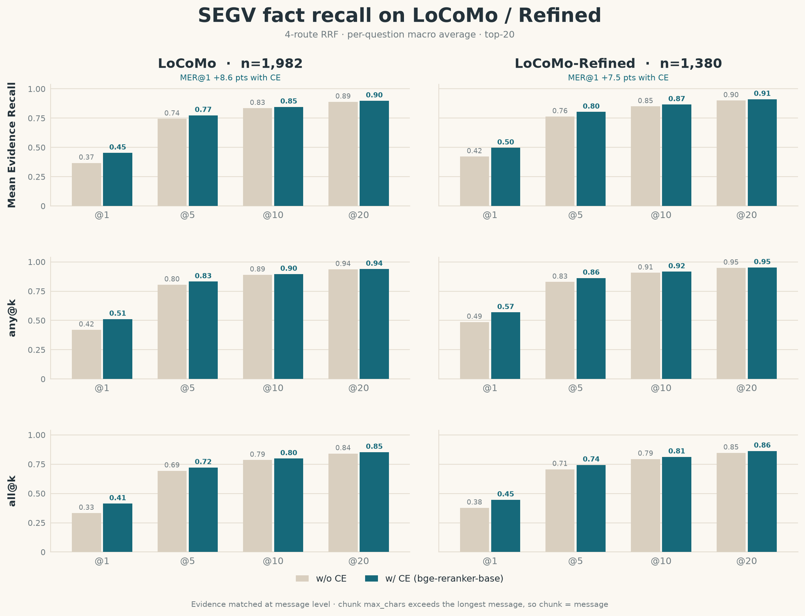
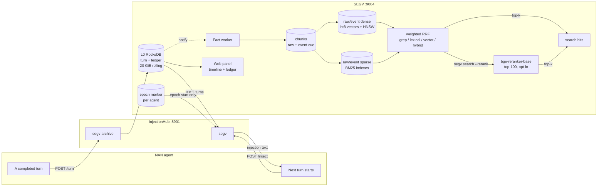
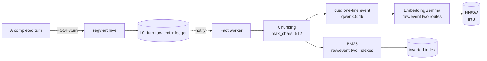
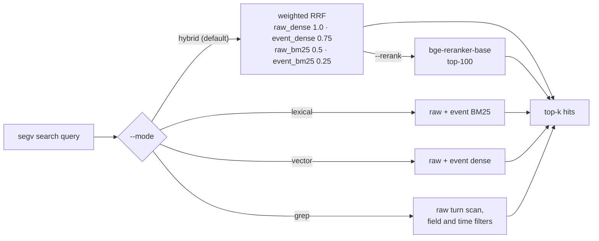
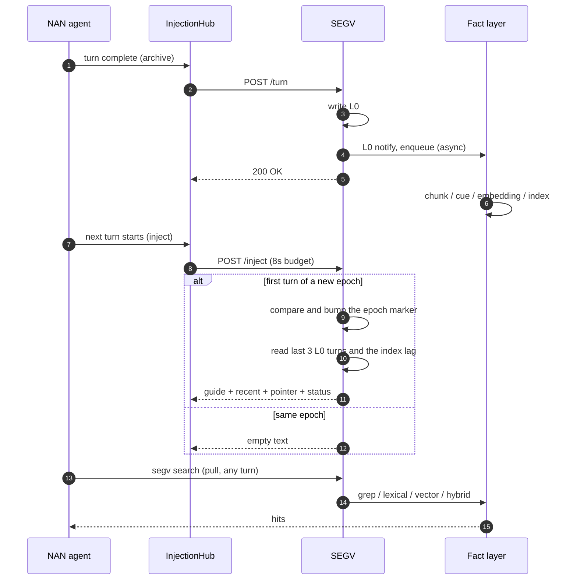

# SEGV Long-Term Memory Service

> This document only covers the `workspace/services/segv` service, not the overall architecture or usage of NAN core.

SEGV is a standalone memory service that listens only on loopback. It observes every completed turn of the NAN agent, splits the raw text into fact chunks and indexes them; at retrieval time the agent pulls history with a single `segv search` tool (grep / lexical / vector / hybrid, cross-encoder reranking on request). Push is deliberately minimal: when the context is cleared and an epoch opens, SEGV injects only a guide, the last three archived turns, a pointer to the newest turn, and an index-health line; every later turn of the same epoch gets an empty string. The service itself does not take part in the conversation and does not call the agent's main model; it works only through two mount points of the InjectionHub:

- `segv-archive`: receives completed turns (`POST /turn`), persists before acknowledging;
- `segv`: injects the epoch opening (`POST /inject`, 8-second budget, degrades to empty text on failure).

## Performance at a Glance

Start with fact recall. Both datasets use four-way fusion; `w/ CE` means the fused result is reranked with `BAAI/bge-reranker-base`, with CE used as a fifth route in a second RRF.



### LoCoMo (n=1,982, four-way fusion)

| Metric | CE | @1 | @5 | @10 | @20 |
|---|---|---|---|---|---|
| Mean Evidence Recall | w/o CE | 0.3677 | 0.7440 | 0.8347 | 0.8889 |
| Mean Evidence Recall | w/ CE | 0.4537 | 0.7742 | 0.8463 | 0.8984 |
| any | w/o CE | 0.4198 | 0.8047 | 0.8895 | 0.9364 |
| any | w/ CE | 0.5121 | 0.8315 | 0.8956 | 0.9390 |
| all | w/o CE | 0.3325 | 0.6937 | 0.7851 | 0.8411 |
| all | w/ CE | 0.4137 | 0.7220 | 0.7982 | 0.8527 |

### LoCoMo-Refined (n=1,380, four-way fusion)

| Metric | CE | @1 | @5 | @10 | @20 |
|---|---|---|---|---|---|
| Mean Evidence Recall | w/o CE | 0.4222 | 0.7636 | 0.8498 | 0.9002 |
| Mean Evidence Recall | w/ CE | 0.4968 | 0.8029 | 0.8665 | 0.9119 |
| any | w/o CE | 0.4862 | 0.8283 | 0.9065 | 0.9486 |
| any | w/ CE | 0.5688 | 0.8623 | 0.9167 | 0.9522 |
| all | w/o CE | 0.3775 | 0.7065 | 0.7942 | 0.8471 |
| all | w/ CE | 0.4464 | 0.7442 | 0.8130 | 0.8630 |

> **Note on @1**: a single slot can hold at most one item, so for any question with more than one gold evidence, `all@1` and `MER@1` are capped by construction (`MER@1 ≤ 1/|gold|`, `all@1 = 0`). The `@1` column measures head precision, not coverage; read coverage from `@5` and above.

### LongMemEval-S (n=500, four-way fusion)

Different scope from the two tables above: here gold is a **set of answer sessions**, not evidence messages, so the unit of scoring is a session rather than a turn.

| Metric | CE | @1 | @5 | @10 | @20 |
|---|---|---|---|---|---|
| Mean Evidence Recall | w/o CE | 0.6044 | 0.9715 | 0.9803 | 0.9803 |
| Mean Evidence Recall | w/ CE | 0.6064 | 0.9761 | 0.9843 | 0.9843 |
| any | w/o CE | 0.9380 | 0.9960 | 0.9980 | 0.9980 |
| any | w/ CE | 0.9400 | 0.9960 | 1.0000 | 1.0000 |
| all | w/o CE | 0.3300 | 0.9300 | 0.9500 | 0.9500 |
| all | w/ CE | 0.3320 | 0.9400 | 0.9540 | 0.9540 |

Every question carries its own haystack (median 48 sessions), and retrieval is isolated per question; the metrics saturate at k=10, so @20 is identical to @10. CE only moves `all@5` (+1.0pp) and `MER@5` (+0.46pp); `any` is already at the ceiling at k=5.

> **Note on @1**: same ceiling as above — most questions have 2+ gold sessions, so `all@1 = 0` and `MER@1 ≤ 1/|gold|` by construction. The low `all@1` (0.33) reflects that, not a ranking failure.

### Evaluation Protocol

- **Dataset**: LoCoMo has 10 sessions and 1,982 questions (of 1,986 questions, 4 had no evidence and were skipped); for LoCoMo-Refined, of 1,382 questions, 2 without evidence were skipped, n=1,380.
- **Session isolation**: retrieval is isolated per session; each question takes top-20.
- **gold**: evidence `dia_id` is prefixed with the session; chunk ids are folded to message level with `split("#")[0]`, and multiple chunks of the same message count only once. In this test the maximum chunk characters is larger than the maximum LoCoMo message length, so chunk level = message level.
- **Metrics**: computed per question and then macro-averaged, with the denominator being the number of questions with evidence:
  - `MER@k = |gold ∩ top-k| / |gold|`
  - `any@k` = at least 1 hit
  - `all@k` = covers all gold
  - k = 1 / 5 / 10 / 20
- **LongMemEval-S scope**: gold is `answer_session_ids` (1–6 sessions per question) and hits are deduplicated to session level, so both LoCoMo columns and the LongMemEval-S table above share the `MER / any / all` definitions but not the evidence unit.

## Overall Architecture



The two paths can be viewed separately.

### Write Path



The `/turn` acknowledgement happens after the L0 write; chunking, cue, embedding, and indexing are all asynchronous and do not block the agent's next turn. Once L0 reaches 20 GiB, the oldest turns are evicted first, pruned to 95%.

### Read Path



`rerank` is off by default: the cross-encoder only runs when the caller asks for it, and only over the top 100 fused candidates. `grep` never touches the index, so it is the fallback while fact is warming and the only mode that honours the `origin`, `role` and `epoch` filters.

## Timing of One Turn



## Memory Layers

| Layer | Content | Location | Rebuildable |
|---|---|---|---|
| **L0** | full JSON of completed turns, global time-ordered ledger | `data/` RocksDB | No, the only source of truth |
| **fact** | chunks (raw text + event cue), two int8 vector routes, HNSW, BM25 | `data/fact/` | Yes, rebuilt from L0 |
| **cache** | per-agent epoch marker: whether an epoch's opening was delivered | `data/cache/` | Yes, deleting it just re-sends one opening |

L0 is the only layer that needs backup; fact and cache are rebuilt on the next start after deletion.

## Epoch Opening and Retrieval

An epoch opens when the core clears its history (`epoch` increments, `origin=context_cleared`). Injection is exactly four blocks, roughly 1.5–2 KB:

| Block | Content |
|---|---|
| `<segv-guide>` | what was lost, where the task actually lives (AGENT.md, notes, the earliest turns), and how to pull with `segv search` / `segv turns` / `segv turn` |
| `<segv-recent>` | the last 3 archived turns, one line each: `[seq] time origin | think | tool`, capped at 300 characters per turn |
| `<segv-pointer>` | the newest archived seq, so the model can read one turn or search below it |
| `<segv-status>` | `index="ok" / "warming"`, `lag_turns`, `latest_seq` |

Every later turn of the same epoch returns an empty string: after the opening, memory is pulled, not pushed. There is no snapshot, no compression, no recall push, and no delivered-ref ledger. Task goals and hard constraints are not injected at all; they live in AGENT.md, notes/, and the earliest archived turns, which the guide points at.

Retrieval has one entry point, `POST /api/search` (also served as `POST /api/recall`):

- `mode=grep|lexical|vector|hybrid|raw|event|bm25|dense`, default `hybrid`; `rerank` defaults to false and enables the cross-encoder only when explicitly passed.
- Filters: `seq_from` / `seq_to` / `before`, `since` / `until` (epoch seconds or ISO), `limit`, `context`, `scan_timeout`, plus `origin` / `role` / `epoch`.
- `mode=grep` and any field filter run a raw turn scan. When the index lags behind L0 and a fact query returns nothing, the request automatically falls back to grep and labels it in `note`.
- The archive is also directly readable through `GET /api/agents/{agent_id}/turns` and `GET /api/agents/{agent_id}/turn`.

All injection blocks (including SEGV's own) are stripped as a whole at the chunking stage and never re-enter the fact store. Any exception inside `/inject` returns empty text only and never fails the agent's turn.

## Running and Configuration

```bash
# standalone start (set NAN_INJECTION_PORT first, or write hub_url directly in config.yaml)
cd workspace/services/segv
NAN_INJECTION_PORT=8901 uv run python main.py
```

Normally it is started by NAN core's `workspace/autostart.sh`, and stops together when the core exits.

| Item | Value |
|---|---|
| Service address | `127.0.0.1:9004` |
| Hub | `127.0.0.1:8901` (archive + inject dual registration) |
| Model service | Ollama `127.0.0.1:11434` |
| Config | `config.yaml`, loaded from the file's directory |
| L0 budget | 20 GiB, pruned to 95% |
| Inject budget | 8 seconds |
| Data dirs | `data/` (L0), `data/fact/`, `data/cache/` |
| Panel | `http://127.0.0.1:9004/` |

Common CLI (`segv` is exposed to the agent shell by `workspace/bin`):

```bash
segv search "why PostgreSQL was rejected" --full
segv search "ORION" --mode grep --since 2026-11-01
segv search "deploy rollback" --mode hybrid --rerank
segv search "budget" --role user --epoch 3
segv state --agent <agent_id>
segv turns --limit 20
segv turn <seq>
segv stats
segv help
```

`SEGV_URL` overrides the service address, and `NAN_AGENT_ID` sets the default agent.

## The Three Models and Resource Usage

| Model | Role | Runtime | Local measurement |
|---|---|---|---:|
| `qwen3.5:4b-mlx` | cue generation | Ollama chat API, 4k ctx | 4.1 GB |
| `embeddinggemma:300m` | raw / event two vector routes | Ollama embeddings, 2k ctx, 768 dims | 673 MB |
| `BAAI/bge-reranker-base` | CE rerank | in-process torch fp16, 100 candidates | 587 MB (process footprint) |

The three models resident together take about **5.4 GB** (macOS unified memory, not dedicated VRAM). Ollama unloads models after about 5 minutes idle, so steady state usually leaves only the reranker (about 0.6 GB), and models load on demand at the next ingest or rerank. The reranker is warmed up in the background after service start, so the first retrieval usually does not wait for model loading.

## Known Boundaries

- **The index trails L0**: cue extraction dominates ingest cost, so search may not cover the newest turns. `<segv-status>` declares the gap, and search falls back to grep when the index is behind.
- **No retrieval at injection**: the epoch opening is three raw turns and a pointer; anything older must be pulled with `segv search`, and the model writes the query itself.
- **L0 evicts the oldest history at 20 GiB**: evicted turns no longer participate in fact rebuilds; when long-term retention is needed, expand capacity or back up first.
- **Loopback only, no authentication**: the panel enables CORS so it can run in a sandbox iframe, so other local web pages can in theory read the service API; do not expose the port to untrusted networks.
- **Single node**: RocksDB, HNSW, and BM25 are all local files with no distributed replicas.

## Layout and Tests

```text
workspace/services/segv/
├── main.py                 # process entry: core app + NAN adapter + two hub links
├── config.yaml             # ports, models, budgets, recent-turn sizes
├── segv/                   # core: protocol-neutral memory engine
│   ├── app.py              # FastAPI trace API, search, SSE, panel CORS
│   ├── record.py           # neutral turn record: messages, stats, meta, raw
│   ├── store.py            # L0: turn, ledger, retention, grep, stats
│   ├── cli.py              # search / state / turns / turn / stats
│   ├── fact/               # chunk, cue, embed, BM25/HNSW, RRF, CE
│   └── cache/              # epoch marker + the opening block
├── segv_nan/               # NAN adapter: /turn, /inject, payload mapping
├── web/                    # timeline + ledger panel (no build step)
├── tests/                  # 38 tests
└── docs/assets/            # figures for this document
```

```bash
uv run --directory workspace/services/segv --frozen pytest -q
```
